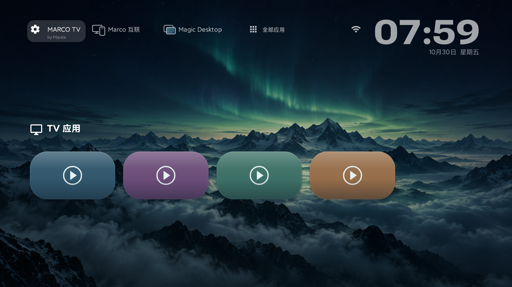

# Marco TV

**Pilipala 开发的免费开源 Android 电视桌面。**

横向卡片、连续焦点动画、四款时间字体与日期、风景壁纸、时钟屏保，以及适合遥控器的自定义设置。

> **本软件免费开源。如果你付费购买了本软件，请尽快向购买平台申请退款。**

作者：**Pilipala** · 版本：**0.14.4（正式版）** · 协议：[GPL-3.0-only](LICENSE)

[](https://pilipala9919.github.io/MarcoTV/showcase/)

**[打开完整产品展示](https://pilipala9919.github.io/MarcoTV/showcase/)** · [GitHub 图文版：24 个模块逐项介绍](docs/产品介绍与功能展示.md)

3 张 0.14.4 新版实机截图、4 张 0.14.2 实机截图、11 张 0.14.1 实机截图、9 张 0.14.0 实机截图与标明版本的历史截图，按日常桌面、外观与操作、系统与媒体、维护与隐私分类。支持搜索、切换截图和放大查看。桌面及播放使用示例内容，私人应用、网络与记录已遮挡。

0.14.4 优化顶部连续焦点、设置进退场和 Magic Desktop 实时绘制；滚动列表增加柔和边界。当前正式版包含在线更新、Marco 互联、持续设置窗口与可撤销的实时预览。验证以小米 Android 9 为主，其他型号、实体手机浏览器及长时间运行的覆盖范围见[验证记录](docs/验证范围.md)。新版设置、Wi-Fi 与预览已更新，菜单路径见[使用说明](docs/使用说明.md)。

## 下载与说明

- **[没有 U 盘？打开安装向导](https://marcotv.wlj9919.top/install/)**：Windows 电脑 / 安卓手机助手、电视浏览器、厂商接收入口，按条件选择路线。
- [安装助手 1.0.0 使用说明](installer/README.md)：内含 0.12.0 正式包，普通网络 ADB；无线配对码暂不支持。

- [下载安装包（Releases）](https://github.com/Pilipala9919/MarcoTV/releases/latest)
- [详细安装说明](docs/安装说明.md)：识别电视 → 开发者模式 → 未知来源 → ADB → 安装和授权 → 默认桌面 → 验收与撤销。
- [详细使用说明](docs/使用说明.md)：遥控器、分类操作栏、卡片、壁纸、时钟、屏保、实时预览、设置排序。
- [各品牌电视设置入口](docs/各品牌电视设置入口.md)：按系统与固件区分入口，标明资料与实测范围。
- [常见问题](docs/常见问题.md) · [隐私说明](docs/隐私说明.md) · [构建说明](docs/构建说明.md)

## 0.14.3 更新

- 首页新增「全部应用」五列抽屉，确定打开，长按进入添加流程；包含在桌面隐藏的可启动应用。
- 默认桌面引导简化：先尝试系统确认页，返回检查状态；厂商锁定时再显示帮助。普通应用无法绕过系统权限强制设置。

## 功能

- 新增[Marco 互联](docs/手机管理.md)：同一局域网扫码并在电视确认，整理卡片、实时预览外观、裁切上传壁纸、下载备份及诊断；不需要安装手机 App 或启用 ADB。

- 内置在线更新：自动检查、可选自动下载、稳定／体验渠道、签名与完整性校验、安装前本地备份、系统确认安装。0.11.1 用户需手动覆盖升级一次。
- 应用入口合并查询及分项诊断，帮助定位无法打开的应用。

- 可选系统最近任务：双击 Home 打开堆叠卡片，以真实任务编号返回原页面；上滑或遥控器上键清除支持单独移除的任务。不透明卡片优先显示缩略图，系统未提供时显示应用 Logo；外观与双击间隔可调。需电脑启动任务辅助服务，完整重启或更新 APK 后需重新启动。
- 本地备份与恢复：自动快照、设置 / 图片导出，恢复前预览并备份原配置。
- 可跳过的首次引导、统一状态检查、本地异常记录和诊断报告导出，不上传日志。
- 应用库常用 / 高级分层、拿起移动与取消；播放来源选择、暂时隐藏及恢复。
- 读取已安装应用和系统输入源；支持收藏、排序、隐藏、改名和自定义封面。
- TV 应用第一张卡片再按左键展开操作栏，选择「添加应用」，可手动添加未识别或隐藏的应用入口。
- 默认按最近从 Marco TV 打开的顺序排列，置顶应用优先；支持首字母与自定义排序。
- 单独卡片设置支持置顶、隐藏和系统确认卸载；图标背景延展到整张卡片。
- Wi-Fi 列表显示名称与信号图标；允许通知使用权后，左上显示媒体应用提供的播放卡片。
- 左上设置，右上 Wi-Fi、时间和日期；四张内置风景壁纸，也支持本地图片。
- 四款时钟字体：现代宽体、修长窄体、柔圆错倾、雅致衬线；圆体倾斜幅度 0–14° 可调，桌面与屏保共用。
- 闲置时放大并提亮时间、压暗背景；可调整等待、大小、亮度和渐变时长。
- 滑块支持左右微调和长按加速，调整时实时预览。
- 卡片行上下位置 0–100%、卡片高度 70–130% 独立调整；应用图像保持比例，预览、保存与备份一致。
- 首页新增 **Magic Desktop**，与 Marco 互联并列；24 项调整集中在右侧窄面板，左侧放大 3D 实时预览，平滑处理斜边与圆角，背后呈现当前壁纸的朦胧底色。
- 设置子页在同一右侧面板中切换，返回恢复刚刚选择的项目；Wi-Fi 保留小气泡和胶囊开关。
- 设置逐级返回，首页再按返回回桌面；Home 可从任意层级直接回桌面。
- 设置按八个主题分组，固定设置列表支持长按确定排序并保存顺序；旧排序自动迁移。
- 可选的默认桌面、开机打开、Home 键兼容与 ADB 调试开关恢复。

## 兼容性

**老电视实验分支：[Marco TV Lite 0.1.2](lite/README.md)**。独立安装，目标最低 Android 4.0；已通过 Android 4.0.2 模拟器基础验证，尚无老电视真机验证。功能与更新渠道独立，不影响下述完整版要求。

**更多机型等待实测反馈，欢迎加入测试！** 请通过 [GitHub Issues](https://github.com/Pilipala9919/MarcoTV/issues) 提交型号、系统版本与具体使用情况。

最低 **Android 6.0 / API 23**，targetSdk 为 28。实际开发和验证设备为 **Xiaomi MiTV-ASTP0、Android 9**。能安装 APK 与 Home 接管、自动恢复全部可用是不同验收项。

其他 Android / Android TV / Google TV 设备可按说明试装，尚未逐台验证。较新系统可能限制 Wi-Fi 配置、后台启动、无障碍授权或网络 ADB。**不适用于三星 Tizen、LG webOS、Roku、Apple tvOS；其他系统需先确认是否兼容 Android APK。** 先按品牌入口表核对实际系统。

普通桌面试用可通过 U 盘安装，不需要先授权 ADB。自动恢复及自动维护 Home 兼容服务，需要电脑通过 ADB 完成一次 `WRITE_SECURE_SETTINGS` 授权。Marco TV 可尝试恢复调试开关，不能保证打开所有设备的网络调试端口。

## 快速开始

1. 在 Releases 免费下载 `MarcoTV-0.14.2.apk`。
2. 按安装说明确认系统，通过安装向导选择助手、电视浏览器、文件接收、U 盘或 ADB 安装。
3. 从原桌面的应用列表打开 **Marco TV**，先验证遥控器和应用启动。
4. 打开首页 **Magic Desktop**，调整壁纸、时钟和卡片；系统功能仍在左上设置齿轮中。
5. 需要默认桌面与自动恢复时，再授权并配置「开机与默认桌面」。

第一次安装保留原厂桌面；恢复流程见安装说明。

## 从源码构建

Windows x64、Python 3.10+：

```powershell
python scripts/bootstrap.py
python scripts/build.py
```

输出位于 `dist/`。工具从官方分发站下载并校验摘要，私钥只留在本机。已有 Android SDK 的 Windows、Linux 或 macOS 也可构建，详见[构建说明](docs/构建说明.md)。自行构建的签名与作者发布包可能不同，不能直接覆盖。

## 开源与署名

Copyright © 2026 **Pilipala**。原创代码、文档及内置生成壁纸按 GPL-3.0-only 发布。保留署名与许可，分发修改版本时注明修改并提供对应源码。第三方字体、图标按各自许可保留原作者声明，见 [NOTICE](NOTICE) 和[资源说明](assets-notes.md)。

作者免费发行软件，不设置购买、会员或激活码。退款提示说明免费发行政策，不是对开源协议另加禁止商业使用条款。

## 反馈与贡献

通过 [Issues](https://github.com/Pilipala9919/MarcoTV/issues) 提交品牌、完整型号、系统版本、应用版本和重现步骤。请遮盖序列号、MAC、家庭 Wi-Fi 名称及地址。品牌入口更正请附厂商说明或去除个人信息的实机路径。

参见[贡献说明](CONTRIBUTING.md)、[安全反馈](SECURITY.md)、[更新记录](CHANGELOG.md)与[验证范围](docs/验证范围.md)。
