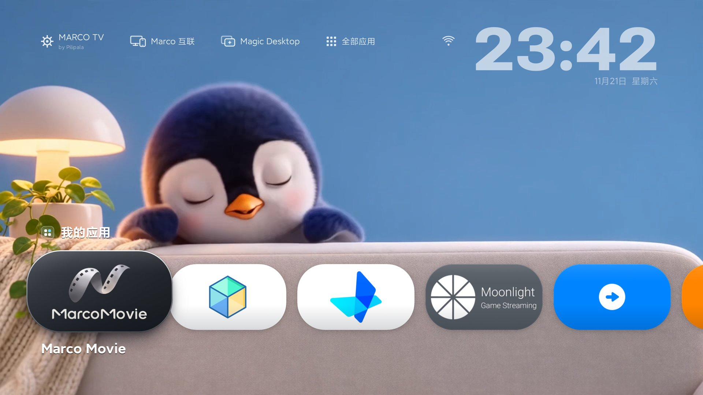
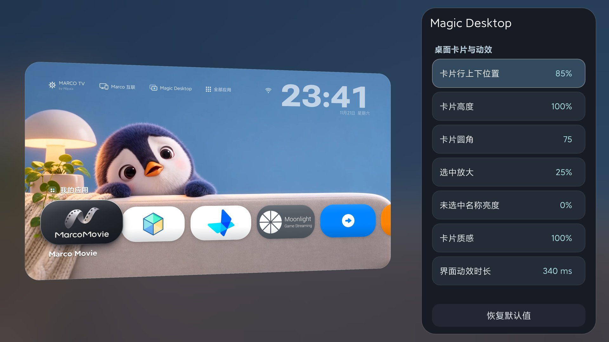
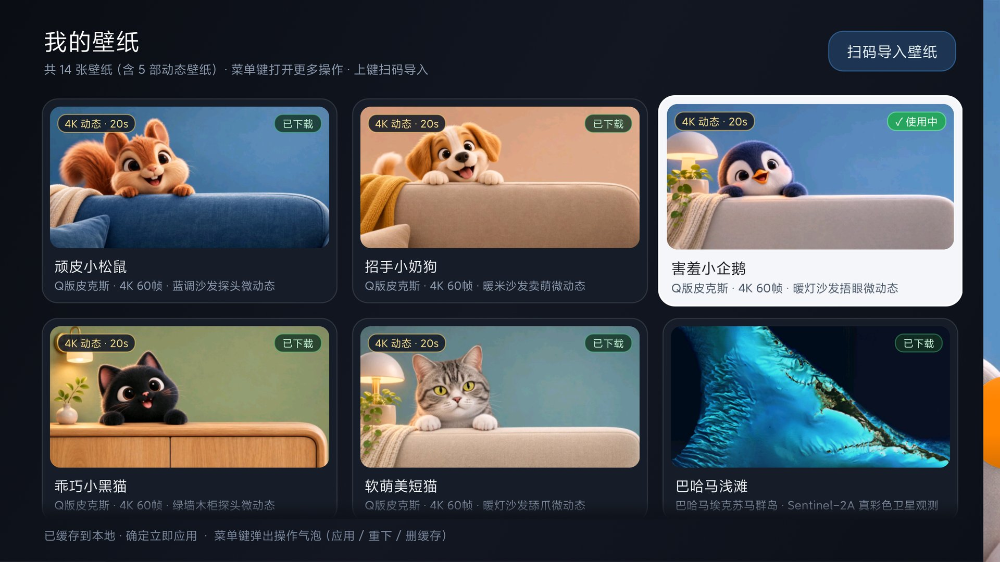
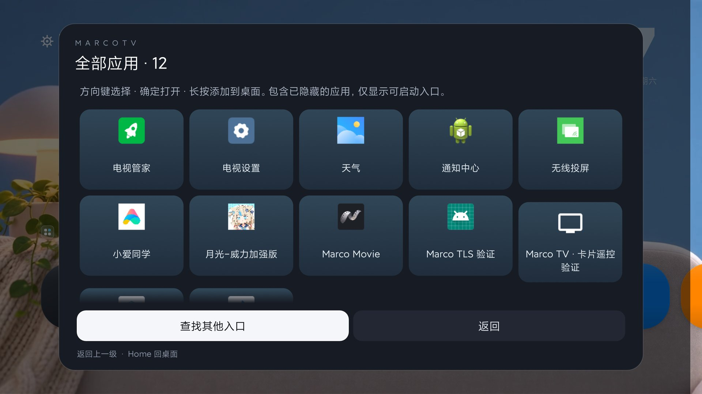
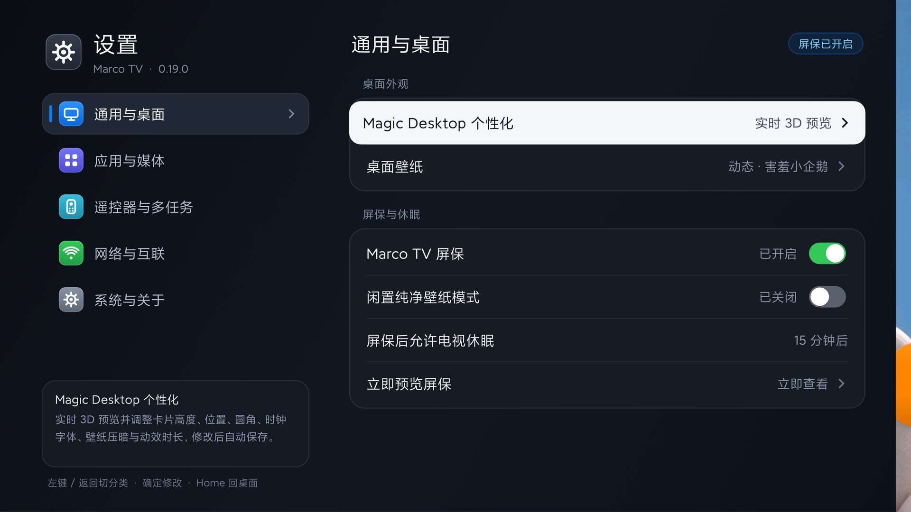
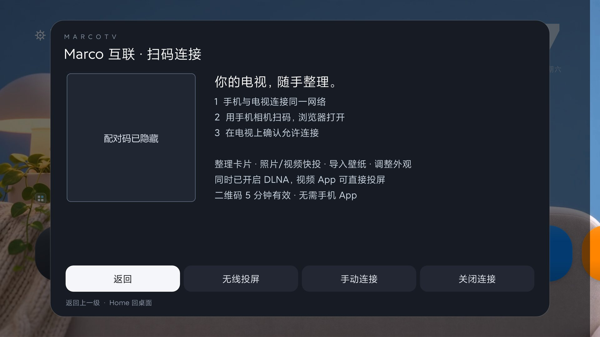

# Marco TV

<p align="center">
<picture>
  <source media="(prefers-color-scheme: dark)" srcset="docs/brand/tv-wordmark-white.png">
  
</picture>
</p>

**把电视桌面做到 Apple TV 的质感，还免费。**

作者：**Pilipala** · 当前版本：**0.21.3** · 协议：[GPL-3.0-only](LICENSE)

Marco TV 是免费开源的 Android 电视桌面：横向卡片、连续焦点动画、4K 60fps 动态壁纸，顺滑得不像第三方桌面。Magic Desktop 24 项调整配 3D 实时预览，卡片长宽、圆角、封面都能单独定制；手机扫码传图、无线投屏、最近任务、本地备份一应俱全。Android 6.0 就能用，老电视还有 Lite 版。

> **本软件免费开源。如果你付费购买了本软件，请尽快向购买平台申请退款。**

[](https://pilipala9919.github.io/MarcoTV/showcase/)

**[打开完整产品展示](https://pilipala9919.github.io/MarcoTV/showcase/)** · [GitHub 图文版：24 个模块逐项介绍](docs/产品介绍与功能展示.md)

3 张 0.14.4 实机截图、4 张 0.14.2 实机截图、11 张 0.14.1 实机截图、9 张 0.14.0 实机截图与标明版本的历史截图，按日常桌面、外观与操作、系统与媒体、维护与隐私分类。支持搜索、切换截图和放大查看。桌面及播放使用示例内容，私人应用、网络与记录已遮挡。

## 界面一览

| | | |
| --- | --- | --- |
| <br>Magic Desktop | <br>我的壁纸 | <br>息屏时钟 |
| <br>全部应用 | <br>双栏设置 | <br>Marco 互联 |

0.21.3 重点优化了默认桌面启用分流、Home/开机验收归因与恢复快照保护：免调试辅助功能入口直达、系统选择器与辅助功能授权支持跨进程事务提交/取消、按启动轮次区分开机恢复请求与可见获焦到达（含 Android 6 `boot_id` 基线/恢复关联及无标识人工观察）、更新原桌面回拉目标同时保护撤销快照、双击 Home 不误判短按、修复 MiTV4 `ps -A` 仅表头误报及任务桥 `--stop` 混合候选分项提示，并保留原生默认桌面手动关闭“开机打开”开关的选择；同时同步推出 **Marco TV Lite 0.3.1**（修复系统选择器「仅此次」误报为已生效默认桌面）。实机验证与覆盖范围见[验证记录](docs/验证范围.md)与[桌面启用验收](docs/一键桌面启用与验收.md)，新版设置路径见[使用说明](docs/使用说明.md)。

## 下载与说明

- **[受限系统兼容测试包](https://github.com/Pilipala9919/MarcoTV/releases/tag/v0.21.3)**：面向安装报错含 `not signature by tcl` 或拦截第三方桌面 `HOME` 的设备，提供 `MarcoTV-0.21.3-Restricted.apk`，移除 HOME 声明，使用 Home 兼容路线。尚待 TCL 安装、按键与重启实测，不能当作已适配；[先读测试说明](docs/受限系统兼容版测试说明.md)。

- **[没有 U 盘？打开安装向导](https://marcotv.wlj9919.top/install/)**：Windows 电脑 / 安卓手机助手、电视浏览器、厂商接收入口，按条件选择路线。
- [安装助手使用说明](installer/README.md)：**1.0.1** 内置经摘要校验的正式安装包（安装后可在桌面「系统与关于 → 软件更新」在线升级至 **0.21.3**），支持 `/8`–`/30` 私有网段查找与普通网络 ADB；无线配对码暂不支持。

- [下载安装包（Releases）](https://github.com/Pilipala9919/MarcoTV/releases/latest)
- [详细安装说明](docs/安装说明.md)：识别电视 → 开发者模式 → 未知来源 → ADB → 安装和授权 → 默认桌面 → 验收与撤销。
- [详细使用说明](docs/使用说明.md)：遥控器、分类操作栏、卡片、壁纸、时钟、屏保、无线投屏、实时预览、设置排序。
- [各品牌电视设置入口](docs/各品牌电视设置入口.md)：按系统与固件区分入口，标明资料与实测范围。
- [常见问题](docs/常见问题.md) · [隐私说明](docs/隐私说明.md) · [构建说明](docs/构建说明.md)

## 0.21.3 更新要点

- **免调试默认桌面分流与事务化取消保护**：「一键启用 Marco TV」在系统未提供桌面选择页但开放辅助功能时直接进入「Home 兼容」确认（无需 ADB），仅提供无线配对码时网页向导与应用指引同步指向手动辅助功能或官方 Android Platform Tools 配对说明；系统选择器与辅助功能授权均改为持久化事务，取消（含进程回收重建后取消、已是默认桌面暂停后取消）完整保留原暂停状态、HOME 别名、独立「开机打开」开关及已有验收记录，且在原生默认桌面日常状态检查中保留用户手动关闭「开机打开」的选择。
- **准确区分默认桌面、按键返回、窗口回拉与开机到达**：验收页分别呈现系统实际 HOME 解析、90 秒 Home 测试来源（系统 HOME／兼容按键或广播／原桌面窗口回拉，双击打开最近任务不误判短按）、按启动轮次去重的开机恢复请求与窗口实际可见获焦到达；Android 6 缺 `boot_count` 时以可靠 `boot_id` 建立基线并关联真实开机恢复，缺乏可靠标识时提供明确标注的人工观察入口。
- **原桌面回拉目标跟踪与撤销快照分离**：用户切换原厂桌面或重新启用兼容时更新窗口与任务桥回拉目标，同时保留本轮首次保存的原始恢复快照；原桌面临时停用时保留快照并允许重试。
- **任务桥 MiTV4 `ps -A` 仅表头回退与状态细分**：电脑端 `scripts/start_task_bridge.py` 与电视端 `HomeShellSetup` 仅在表头 PID 列存在有效数字行时接受 `ps -A`，否则回退普通 `ps`；电脑端区分「已确认运行」「已观察到进程但稳定性尚未确认」「发现候选进程但身份无法核实」「确认未运行」「无法验证进程列表」，`--stop` 遇到混合已核实与身份不可读候选时仅停止前者并分别报告 PID。
- **同步发布 Marco TV Lite 0.3.1**：修复系统选择器点击「仅此次」被误判为「当前已生效」的问题，改为以系统实际默认 HOME 解析判定，独立区分临时打开、已设为默认、其他桌面与受限版普通启动。

## 0.21.2 更新要点

- **Android 6.0–7.1（API 23–25）任务辅助服务与老固件启动脚本兼容修复**：修复 `TaskBridgeServer` 在构造函数、`canRemove()` 与 `publish()` 直接调用 API 26 才引入的 `ActivityManager.getService()` 导致的崩溃，统一回退 `ActivityManagerNative.getDefault()`；移除 `HomeShellSetup` 与 `scripts/start_task_bridge.py` 对 `pidof` 的依赖并改为表头感知的 `ps -A` / `ps` 回退，补齐 `am get-current-user`、`pm list packages -U`（`dumpsys package` 多用户 UID）与 `pm path` 老固件兼容以及双次存活确认。

## 0.21.1 更新要点

- **完整版 APK 打包解析兼容修复（面向 TCL 等严格安装器）**：同步 `build_lite.py` 的标准 ZIP 头规范化至 `scripts/build.py`，修复 `aapt2` 原始条目 `extract_version=0` 问题并统一为 PKZIP 标准 `10`/`20`；在清单中显式声明定位、GPS、Wi-Fi 与横屏硬件特性为 `required="false"` 并改用 `@string/app_name`；显式启用 `--min-sdk-version 23` 与 v1/v2/v3 全方案签名，并新增离线回归校验与常见问题排查说明。

## 0.21.0 更新要点

- **全面统一 MarcoTV 品牌视觉与图标语言**：启用原创 **紫调三层叠卡（Purple Stacked Cards）** 品牌资产体系，同步更新完整版与 Lite 版全密度 PNG 应用图标、Android 8.0+ 自适应图标、Android TV 深色横幅（`app_banner`）、首页顶栏 `MARCO TV` 动态叠卡徽标与薰衣草紫焦点点缀、设置页品牌徽标、Marco 互联手机网页及官网展示/安装向导页。
- **完整版应用管理与卸载全面升级**：「设置 → 应用与媒体」新增集中式 **「应用管理与卸载」**（支持全部/可卸载/已隐藏/系统四档筛选，用户应用置前排列）；「全部应用」抽屉长按直接弹出完整应用管理/卸载菜单；桌面长按一级菜单新增直达 **「卸载应用」**，修复手动添加 `包名/组件名` 卡片卸载时的包名截取并正确区分可卸载更新的系统应用。
- **Marco TV Lite 0.3.0 同步下放多项完整版核心特性**：在保持纯 API 14 编译、零联网权限与约 352 KiB 轻巧体积的前提下，新增收藏分组双行切换、「拿起并移动」拖拽排序、单卡纯色/本地图片封面与实时预览、3 款零体积渐变主题壁纸、媒体音量直调、屏保休眠定时、一键屏保、全部应用 5 分类筛选与搜索以及 3 项 Magic Desktop 进阶参数。

## 0.20.0 更新要点

- **全卡片自定义长宽高与手机扫码上传封面**：支持为「我的应用」「收藏」「输入源」「其他应用」的任意卡片单独或全局调整宽度、高度、3D 立体厚度与圆角，电视端长按「自定义长宽高」即可实时 3D 预览，长按「手机扫码上传图片…」可在手机浏览器按卡片比例裁切上传高清封面（支持混排布局、LRU 高斯模糊阴影缓存与本地备份恢复）。
- **顶栏精简与四图标统一焦点动效**：移除首页左上 `MARCO TV` 下方 `by Pilipala` 副标题并统一四项标签基线，顶栏四个图标全面加入临界阻尼弹簧焦点动效与冰蓝玻璃态高亮细节。
- **云端 4K 60fps 动态壁纸与 APK 瘦身**：移除内置大体积风景壁纸改为镜像站云端目录按需下发（含原创 4K 60fps Q 版皮克斯动态壁纸），解耦下载与应用操作并新增侧边气泡菜单；修复小米 `MiPlayer` 释放死锁与返回桌面闪烁卡顿。
- **高斯模糊阴影、扩大卡片下移范围与投屏发现增强**：桌面卡片升级真实高斯模糊缓存阴影，扩大「我的应用」卡片行向下移动阈值并消除上行露头、精调 Magic Desktop 3D 倾角边距；新增 Bonjour mDNS 广播、iOS 可探测 DLNA 端口、1900 端口 SSDP 回复与 UPnP 1.0 SCPD 兼容性。

## 0.19.0 更新要点

- **统一「我的壁纸」缩略图画廊与动态视频壁纸**：壁纸选择独立回归「设置 → 通用与桌面 → 桌面壁纸」，仅保留「我的壁纸」与「扫码导入壁纸」；在线静态与动态壁纸（含原创 Q 版皮克斯动态壁纸）统一由镜像站 `catalog.json` 云端下发（HTTPS + SHA-256 校验，断网可用），支持手机扫码上传照片/MP4/WebM 或粘贴视频直链导入、长按重命名/删除与「闲置纯净壁纸模式」，并采用全后台串行硬件解码释放避免电视切页卡顿。
- **Magic Desktop 折叠参数、自动保存与 3D 流畅度优化**：全部参数卡片改为点击展开滑块、调整即刻自动保存，移除保存/取消按钮；以硬件圆角裁剪与 GPU 原生 3D 变换重构预览舞台，大幅优化进场与切场掉帧。
- **桌面应用卡片高清锐化与 Apple TV 光学玻璃质感**：优先按 `640dpi` 采样并启用 MipMap 渲染，消除二次缩放与旧版白雾遮罩，新增静止整数像素对齐、选中态微视差缩放、对角玻璃掠光、4 层悬浮投影与锐利内高光描边。

## 0.18.0 更新要点

- **镜像在线精选壁纸库与左右分栏预览**：在「桌面壁纸 → 在线精选壁纸」按需拉取镜像站 `marcotv.wlj9919.top/wallpapers/` 的 4K 精选壁纸，采用左侧固定 16:9 预览卡 + 右侧滚动列表的 Apple TV 分栏布局，经 HTTPS 与 SHA-256 校验后缓存到本地，下载后断网仍可切换并支持一键清理缓存。
- **自定义壁纸上限放宽至 50 MB / 12K 原图**：Marco 互联网页上传、电视本地导入与备份恢复的单张背景图上限统一由 16 MB / 3200 万像素放宽至 50 MB / 1 亿像素（最大单边 16384 px），自动按屏幕分辨率安全降采样渲染。
- **最近任务服务本机一键启动修复**：修复 `HomeShellSetup` 在传统 ADB `shell:` 伪终端下后台启动 `TaskBridgeServer` 被 `SIGHUP` 秒杀导致最近任务始终无法获取的问题（新增 `trap '' HUP` + `setsid` 独立会话启动）；补齐旧进程重启时的文件锁等待与重试机制；延长连接等待至 7 秒，并在设置「遥控器与多任务 → 立即打开最近任务」中实时显示连接状态。
- **桌面置顶视觉精简**：移除置顶应用卡片右上角星标及手机互联端 `★` 标记，保留长按「置顶到首位 / 取消置顶」及置顶优先排序。

## 0.17.0 更新要点

- **待机强杀恢复与唤醒回桌面**：针对小米等电视待机时系统强制停止第三方桌面并清空无障碍服务的固件机制，在不改动任何厂商私有配置、不触碰其他无障碍服务的前提下，仅在灭屏待机中断且已授权、未暂停时自动恢复 Marco TV 自身的 `HomeKeyService` 与 `RecoveryService`，并在唤醒稳定后切回桌面；若未能后台恢复，下次打开桌面时明确询问并由用户确认。
- **Apple TV 风格双栏设置重构与消除蒙版**：设置整体重新归类为「通用与桌面」「应用与媒体」「遥控器与多任务」「网络与互联」「系统与关于」5 个扁平一级分类，左右分栏、原地开关与左下角动态说明卡大幅减少层层嵌套；主设置及设置子页采用完全不透明深色画布，独立弹窗改用不透明面板与纯白焦点高亮胶囊，彻底消除部分电视上的灰白蒙版感与底层时钟透字。
- **桌面视觉与交互升级**：长按应用卡片首位新增「置顶到首位 / 取消置顶」（跨所有排序模式记录置顶先后顺序并立即聚焦首位）；主应用行更名为「我的应用」并重绘磨砂玻璃徽标，顶栏四个按钮及 Wi-Fi 图标改为像素对齐的纯矢量绘制并实现等距排布。

## 0.16.0 更新要点

- **跨版本与多设备适配**：补齐 `TaskBridgeServer` 在 Android 6–14 的 4 代 Binder `IContentProvider.call` 签名与 `List`/`ParceledListSlice` 兼容、`/mnt/expand/` 扩容存储及 Android 11+ `~~` 路径支持、FBE 开机锁屏（Direct Boot）保护、系统桌面 `ResolverActivity` 兜底枚举；新增视口 DPI 与字号归一化（修复廉价盒子 `160dpi` 缩水与超大字号裁切，标准 `1080p@320dpi` 与 `4K@640dpi` 保持像素一致）以及 `NUMPAD_ENTER`、手柄 `BUTTON_A`、`repeatCount` 长按兼容。
- **无线投屏中心模块化与安全加固**：提供局域网 DLNA 影视接收、Miracast 系统镜像入口跳转及 Marco 互联网页/本地视频推送；采用有界线程池、单 IP 速率限制、严格 `Host`/`Origin`/`SOAPAction`/`Content-Type` 校验（阻断浏览器 CSRF 与 DNS 重绑定）、陌生设备电视弹窗确认、URI 回显脱敏与受控 `FileProvider` 外部播放器授权。
- **低配内存、存储与反馈闭环**：消除 256 MB 投屏上传双倍拷贝与孤儿封面/导出缓存残留，收紧 1 GB 低内存设备图片驻留并补齐 Android 4.x Lite 位图回收；补齐投屏与最近任务开关的备份恢复；修复问题反馈电视直传与扫码提交编号冲突，并通过 `networkSecurityConfig` 强制云端更新与反馈仅走 HTTPS。

## 0.15.0 桌面启用

系统支持时直接选择默认桌面；需要调试时按本机指引完成授权，返回后自动继续。实际 Home 与重启效果分别检查。更多机型待实测反馈，欢迎加入。

## 0.14.3 – 0.14.4 更新

- 首页新增「全部应用」五列抽屉，确定打开，长按进入添加流程；包含在桌面隐藏的可启动应用。
- 默认桌面引导简化：先尝试系统确认页，返回检查状态；厂商锁定时再显示帮助。普通应用无法绕过系统权限强制设置。

## 功能

- 新增[Marco 互联](docs/手机管理.md)：同一局域网扫码并在电视确认，整理卡片、实时预览外观、裁切上传壁纸、下载备份及诊断；不需要安装手机 App 或启用 ADB。

- 内置在线更新：自动检查、可选自动下载、稳定／体验渠道、签名与完整性校验、安装前本地备份、系统确认安装。0.11.1 用户需手动覆盖升级一次。
- 应用入口合并查询及分项诊断，帮助定位无法打开的应用。

- 可选系统最近任务：双击 Home 打开堆叠卡片，以真实任务编号返回原页面；上滑或遥控器上键清除支持单独移除的任务。不透明卡片优先显示缩略图，系统未提供时显示应用 Logo；外观与双击间隔可调。需电脑启动任务辅助服务，完整重启或更新 APK 后需重新启动。
- 本地备份与恢复：自动快照、设置 / 图片导出，恢复前预览并备份原配置。
- 可跳过的首次引导、统一状态检查、本地异常记录和诊断报告导出，不上传日志。
- 应用库常用 / 高级分层、拿起移动与取消；播放来源选择、暂时隐藏及恢复。
- 读取已安装应用和系统输入源；支持收藏、排序、隐藏、改名和自定义封面。
- TV 应用第一张卡片再按左键展开操作栏，选择「添加应用」，可手动添加未识别或隐藏的应用入口。
- 默认按最近从 Marco TV 打开的顺序排列，置顶应用优先；支持首字母与自定义排序。
- 单独卡片设置支持置顶、隐藏和系统确认卸载；图标背景延展到整张卡片。
- Wi-Fi 列表显示名称与信号图标；允许通知使用权后，左上显示媒体应用提供的播放卡片。
- 左上设置，右上 Wi-Fi、时间和日期；四张内置风景壁纸，也支持本地图片。
- 四款时钟字体：现代宽体、修长窄体、柔圆错倾、雅致衬线；圆体倾斜幅度 0–14° 可调，桌面与屏保共用。
- 闲置时放大并提亮时间、压暗背景；可调整等待、大小、亮度和渐变时长。
- 滑块支持左右微调和长按加速，调整时实时预览。
- 卡片行上下位置 0–100%、卡片高度 70–130% 独立调整；应用图像保持比例，预览、保存与备份一致。
- 首页新增 **Magic Desktop**，与 Marco 互联并列；24 项调整集中在右侧窄面板，左侧放大 3D 实时预览，平滑处理斜边与圆角，背后呈现当前壁纸的朦胧底色。
- 设置子页在同一右侧面板中切换，返回恢复刚刚选择的项目；Wi-Fi 保留小气泡和胶囊开关。
- 设置逐级返回，首页再按返回回桌面；Home 可从任意层级直接回桌面。
- 设置按八个主题分组，固定设置列表支持长按确定排序并保存顺序；旧排序自动迁移。
- 可选的默认桌面、开机打开、Home 键兼容与 ADB 调试开关恢复。

## 兼容性

**老电视实验分支：[Marco TV Lite 0.3.1](lite/README.md)**。独立安装，目标最低 Android 4.0（修复系统选择器「仅此次」误报为默认桌面，延续 0.3.0 品牌紫调叠卡视觉、应用管理与系统卸载、收藏行、拿起并移动、单卡封面与长宽高自定义、3 款零体积主题壁纸、媒体音量、屏保休眠定时及分类搜索，另提供无 `HOME` 声明的受限兼容测试包）；已通过 25+ 项本地与运行时默认桌面校验、API 14 真编译与小米 Android 9 历史实机界面验证，Android 4.x/5.1 老电视真机仍待实测反馈。功能与更新渠道独立，不影响下述完整版要求。

**更多机型等待实测反馈，欢迎加入测试！** 请通过 [GitHub Issues](https://github.com/Pilipala9919/MarcoTV/issues) 提交型号、系统版本与具体使用情况。

最低 **Android 6.0 / API 23**，targetSdk 为 28。实际开发和验证设备为 **Xiaomi MiTV-ASTP0、Android 9**。能安装 APK 与 Home 接管、自动恢复全部可用是不同验收项。

其他 Android / Android TV / Google TV 设备可按说明试装，尚未逐台验证。较新系统可能限制 Wi-Fi 配置、后台启动、无障碍授权或网络 ADB。**不适用于三星 Tizen、LG webOS、Roku、Apple tvOS；其他系统需先确认是否兼容 Android APK。** 先按品牌入口表核对实际系统。

普通桌面试用可通过 U 盘安装，不需要先授权 ADB。自动恢复及自动维护 Home 兼容服务，需要电脑通过 ADB 完成一次 `WRITE_SECURE_SETTINGS` 授权。Marco TV 可尝试恢复调试开关，不能保证打开所有设备的网络调试端口。

## 快速开始

1. 在 Releases 免费下载 `MarcoTV-0.21.3.apk`（或最新版本）。
2. 按安装说明确认系统，通过安装向导选择助手、电视浏览器、文件接收、U 盘或 ADB 安装。
3. 从原桌面的应用列表打开 **Marco TV**，先验证遥控器和应用启动。
4. 打开首页 **Magic Desktop**，调整壁纸、时钟和卡片；系统功能仍在左上设置齿轮中。
5. 需要默认桌面与自动恢复时，再授权并配置「开机与默认桌面」。

第一次安装保留原厂桌面；恢复流程见安装说明。

## 从源码构建

Windows x64、Python 3.10+：

```powershell
python scripts/bootstrap.py
python scripts/build.py
```

输出位于 `dist/`。工具从官方分发站下载并校验摘要，私钥只留在本机。已有 Android SDK 的 Windows、Linux 或 macOS 也可构建，详见[构建说明](docs/构建说明.md)。自行构建的签名与作者发布包可能不同，不能直接覆盖。

## 开源与署名

Copyright © 2026 **Pilipala**。原创代码、文档及内置生成壁纸按 GPL-3.0-only 发布。保留署名与许可，分发修改版本时注明修改并提供对应源码。第三方字体、图标按各自许可保留原作者声明，见 [NOTICE](NOTICE) 和[资源说明](assets-notes.md)。

作者免费发行软件，不设置购买、会员或激活码。退款提示说明免费发行政策，不是对开源协议另加禁止商业使用条款。

## 捐赠支持

Marco TV 完全免费开源，捐赠全凭自愿，不影响任何功能。感谢你的支持。

| 微信收款码 | 支付宝收款码 |
| --- | --- |
|  |  |

## 反馈与贡献

通过 [Issues](https://github.com/Pilipala9919/MarcoTV/issues) 提交品牌、完整型号、系统版本、应用版本和重现步骤。请遮盖序列号、MAC、家庭 Wi-Fi 名称及地址。品牌入口更正请附厂商说明或去除个人信息的实机路径。

参见[贡献说明](CONTRIBUTING.md)、[安全反馈](SECURITY.md)、[更新记录](CHANGELOG.md)与[验证范围](docs/验证范围.md)。
