# Marco TV 产品介绍与功能展示

作者：**Pilipala** · 版本：**0.14.0** · 更新：2026-10-29

**把电视桌面，整理成自己的样子。**

Marco TV 是适合遥控器操作的免费开源 Android 电视桌面。从应用卡片、时间与壁纸，到播放状态、系统任务与本地诊断，常用操作围绕大屏与方向键设计。

**更多机型等待实测反馈，欢迎加入测试！** 在 [GitHub Issues](https://github.com/Pilipala9919/MarcoTV/issues) 分享电视型号、系统版本和实际使用情况，一起完善兼容性。

> 本软件免费开源。如果你付费购买了本软件，请尽快向购买平台申请退款。

[在线产品展示](https://pilipala9919.github.io/MarcoTV/showcase/) · [免费下载安装包](https://github.com/Pilipala9919/MarcoTV/releases/latest) · [项目首页](../README.md)

> 本文已更新为 0.14.0。新版桌面、互联、设置、预览和网络使用本次实机素材；其他图片保留为明确标注的历史参考。当前菜单路径见[使用说明](使用说明.md)。

## Marco 互联：你的电视，随手整理

电视首页打开 Marco 互联，手机扫码并在电视确认，即可整理卡片、预览外观、上传壁纸、下载本地备份和脱敏诊断。无需手机 App，仅限同一局域网；当前不提供全局遥控、投屏和云端远程控制。

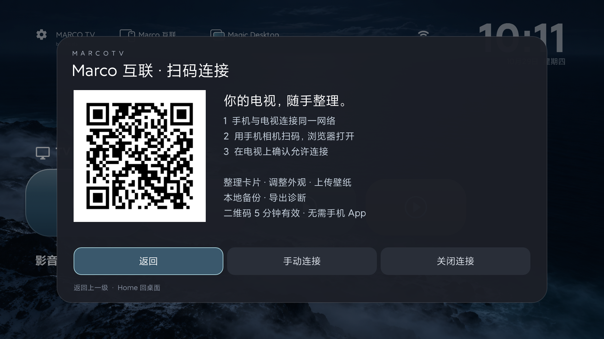

[连接与使用说明](手机管理.md)

## 0.14.0 新界面

首页 **Magic Desktop** 将 20 项参数集中到右侧窄面板，左侧显示放大的 3D 实时预览。新的设置子页原位切换，返回恢复原焦点。

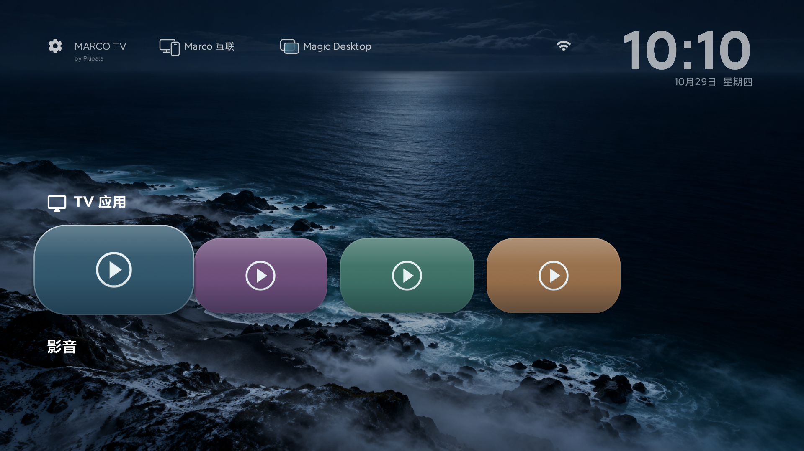

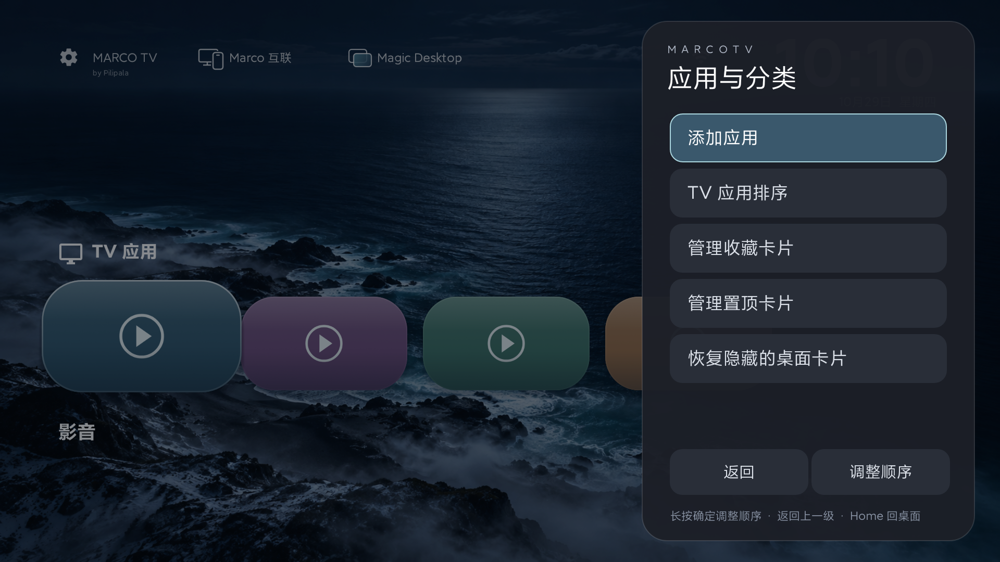

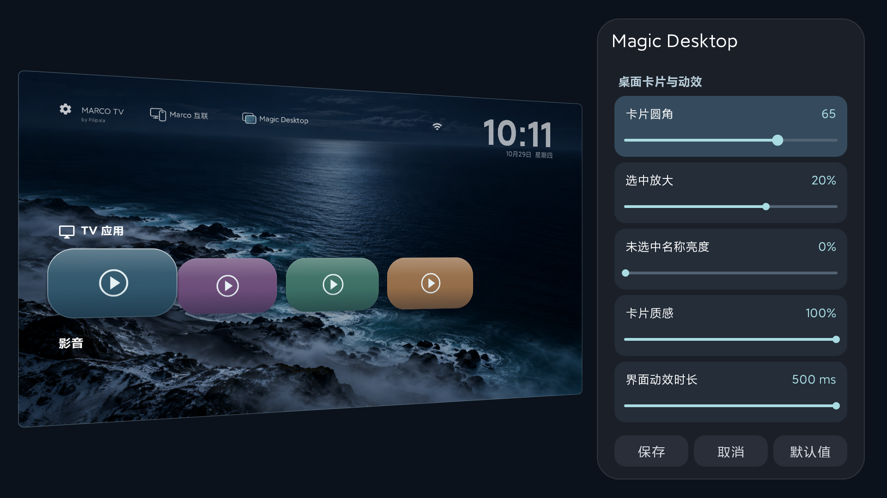

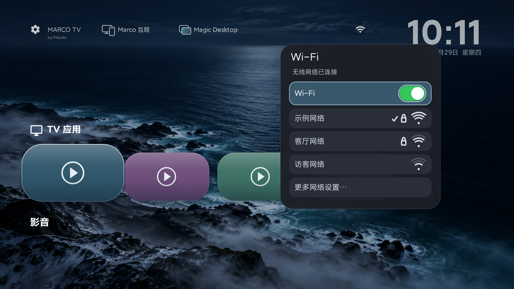

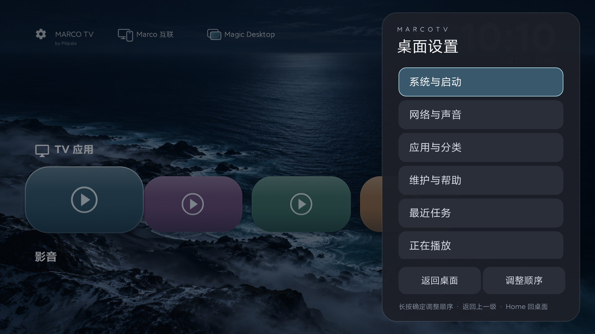

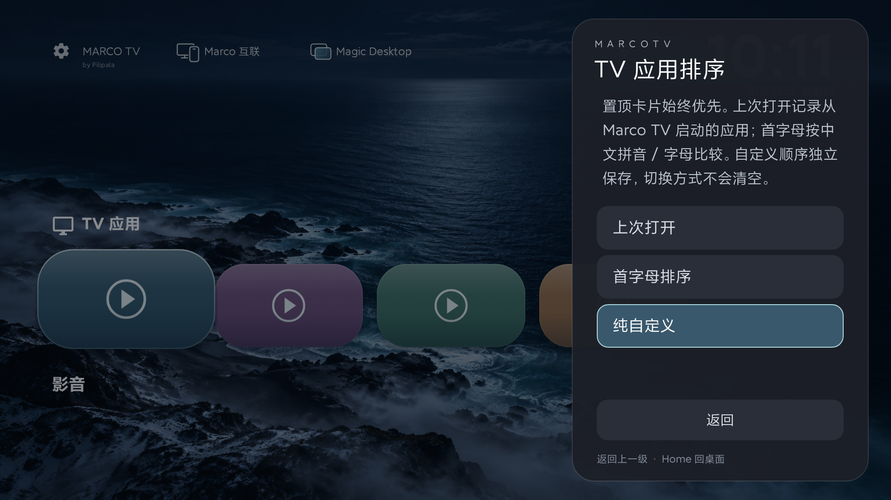

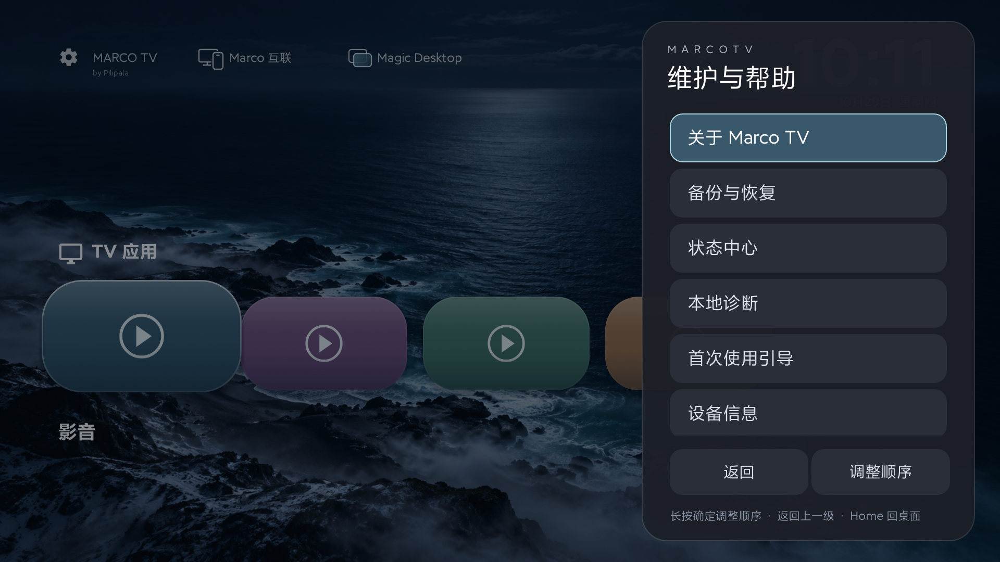

## 展示与隐私说明

九张新版素材来自 0.14.0，其余图片为 0.11.1 历史界面。新版采用内置壁纸、示例网络与无效配对码。桌面卡片、收藏、输入源与播放会话使用临时示例数据；真实应用名称、图标、Wi-Fi 名称、检查时间及存储数值已按需遮挡。示例不代表软件预装应用、片源或会员。截图仅用于功能展示，不作为各品牌兼容性或持续运行的证明。

原始截图、界面树、真实日志、备份和设备连接信息不包含在公开展示中。马赛克区域使用独立生成的不透明色块替换原像素后再导出，公开图片不保留原图或 EXIF。公开素材与摘要见 [素材清单](showcase/asset-manifest.json)。

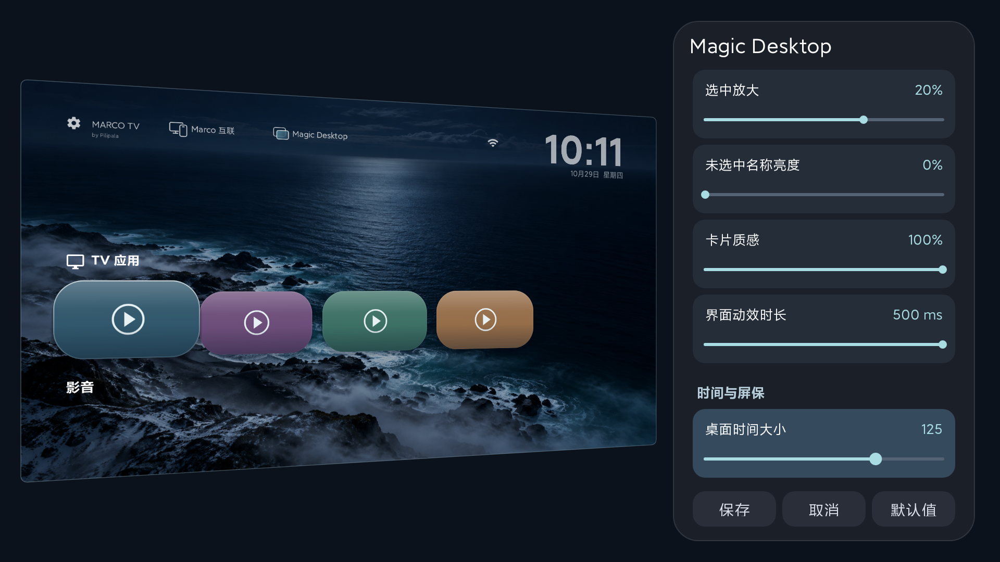

## 模块目录

| 模块 | 能做什么 |
| --- | --- |
| [1｜桌面与遥控器](#desktop) | 用横向卡片组织常用入口，让电视打开后先看到自己的桌面。 |
| [2｜收藏与输入源](#rows) | 把经常使用的内容放进收藏，按电视提供的入口切换输入源。 |
| [3｜左侧分类操作栏](#drawer) | 到达最左侧后展开操作栏，常用操作不用绕进多层菜单。 |
| [4｜应用库与手动添加](#library) | 补上未自动识别的入口，也能按名称或包名查找。 |
| [5｜单张卡片管理](#card-settings) | 常用应用置顶，少用入口隐藏，卸载前保留系统确认。 |
| [6｜名称、封面与收藏](#card-art) | 让每张卡片适合自己的使用习惯。 |
| [7｜排序与拿起移动](#sorting) | 默认把最近从桌面打开的应用放在前面，也支持手动编排。 |
| [8｜Magic Desktop · 实时预览](#appearance) | 左侧看放大的 3D 桌面，右侧集中调整 20 项参数。 |
| [9｜四张壁纸与本地导入](#wallpapers) | 雾蓝海岸、暖沙丘、极夜山脊与峡谷，也可以用自己的图片。 |
| [10｜时间与日期](#clock) | 粗体时钟放在右上角，日期紧随其下。 |
| [11｜放大时钟屏保](#screensaver) | 闲置后放大并提亮时间，同时压暗壁纸。 |
| [12｜设置导航与顺序调整](#menus) | 设置在同一右侧面板原位切换，返回恢复刚刚选中的项目。 |
| [13｜网络与 Wi-Fi](#wifi) | 热点名称搭配信号图标，减少不必要的信息堆叠。 |
| [14｜音量与设备信息](#device) | 常用设备设置放进统一界面，反馈问题时容易核对版本。 |
| [15｜桌面正在播放卡片](#now-playing) | 回到桌面时，仍能看到播放器提供的标题、封面和状态。 |
| [16｜播放控制与来源选择](#media-control) | 有多个播放器时自己选择展示来源，也能临时收起卡片。 |
| [17｜系统最近任务](#recents) | 堆叠卡片返回上次页面，支持清除单个系统任务。 |
| [18｜最近任务外观与交互](#recents-style) | 把卡片大小、倾斜和动画调到适合屏幕与遥控器的程度。 |
| [19｜默认桌面、Home 与开机恢复](#startup) | 按电视能力选择接管方式，并把状态留在界面里。 |
| [20｜首次启动引导](#guide) | 先试用桌面，再按需要开启系统能力。 |
| [21｜统一状态检查](#status) | 把默认桌面、权限、服务和播放状态集中在同一处。 |
| [22｜本地备份与恢复](#backup) | 把外观和卡片配置带走，恢复前先看会改变什么。 |
| [23｜本地诊断与异常线索](#diagnostics) | 遇到异常时先检查、预览报告，再决定是否分享。 |
| [24｜Pilipala · 免费开源](#opensource) | Marco TV 免费发行，没有会员、激活码或购买入口。 |

## 1｜桌面与遥控器

用横向卡片组织常用入口，让电视打开后先看到自己的桌面。

**入口：** 从原桌面打开 Marco TV；配置完成后可用 Home 返回。

- 左右选择卡片，上下切换分类或顶部入口，确定打开。
- 左上设置齿轮旁是 Marco 互联与 Magic Desktop，右上查看时间、日期与 Wi-Fi。
- 长按确定编辑卡片；菜单键打开设置。

**适用条件：** 卡片来自已安装应用；不附带视频会员、频道源或付费影视。图中卡片为临时演示内容。

0.14.0 · 新版桌面 · Marco 互联入口与横向卡片

## 2｜收藏与输入源

把经常使用的内容放进收藏，按电视提供的入口切换输入源。

**入口：** 卡片长按 → 加入收藏；桌面上下切换分类。

- 加入收藏后显示收藏行，原分类中的入口仍然保留。
- 名称和封面在收藏与原分类共用，行内顺序分别保存。
- 选中输入源后按确定，交给电视系统完成切换。

**适用条件：** 输入源是否出现及能否切换由固件决定；图中的收藏、HDMI 入口为临时示例，不表示所有电视都提供相同端口。

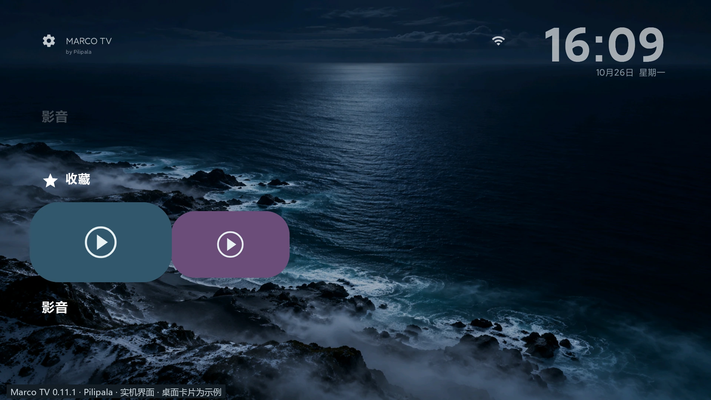

0.11.1 历史界面 · 收藏行示例。

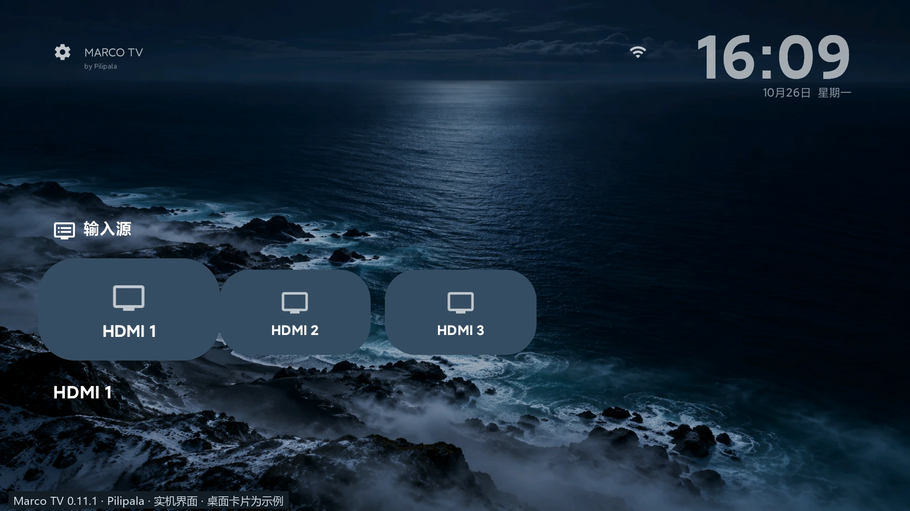

0.11.1 历史界面 · 输入源行示例。

## 3｜左侧分类操作栏

到达最左侧后展开操作栏，常用操作不用绕进多层菜单。

**入口：** 当前行第一张卡片 → 松开左键 → 再按一次左键。

- 选择添加应用、编辑当前卡片、卡片外观、时钟与屏保或桌面设置。
- 按右键或返回收回操作栏，回到卡片。

**适用条件：** 添加应用位于左侧菜单，不占用桌面的一张应用卡片。

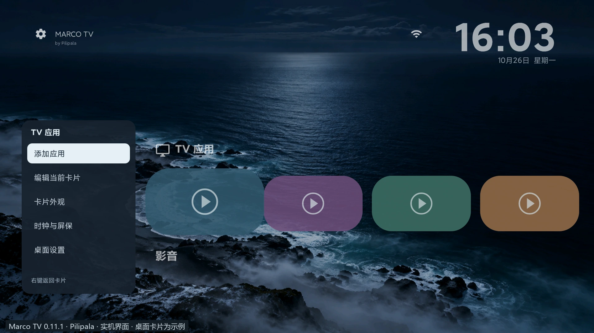

0.11.1 历史界面 · 左侧操作栏展开，应用卡片平滑让出位置。

## 4｜应用库与手动添加

补上未自动识别的入口，也能按名称或包名查找。

**入口：** 左侧分类操作栏 → 添加应用。

- 在常用列表中选择应用，添加后定位到新卡片。
- 通过搜索名称或包名缩小范围。
- 需要更多入口时打开高级列表，查看系统组件与其他可启动入口。

**适用条件：** 高级入口可能不适合电视或需要厂商权限；添加入口不会安装应用。实机应用名称已用马赛克遮挡。

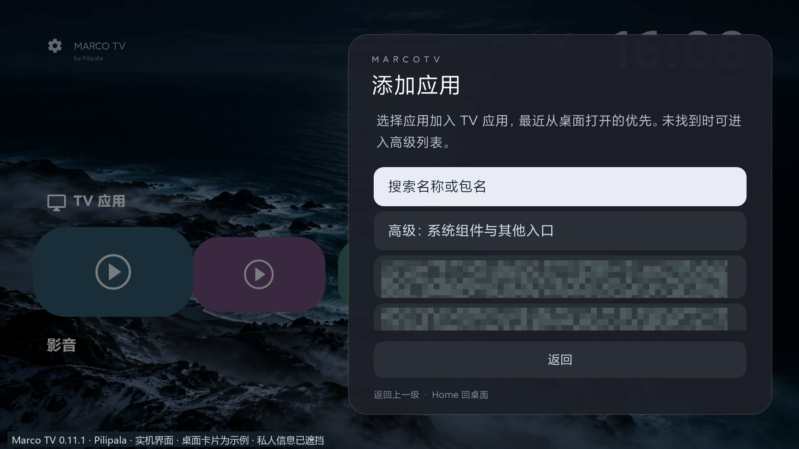

0.11.1 历史界面 · 搜索、常用列表和高级入口；真实应用清单已遮挡。

## 5｜单张卡片管理

常用应用置顶，少用入口隐藏，卸载前保留系统确认。

**入口：** 长按卡片 → 单独卡片设置。

- 置顶卡片始终优先排列。
- 隐藏仅从桌面与收藏收起，可在设置中恢复单张或全部。
- 选择卸载会进入系统确认；不在桌面里静默删除应用。

**适用条件：** 系统应用可能无法卸载；隐藏不等于卸载，也不会清除应用数据。

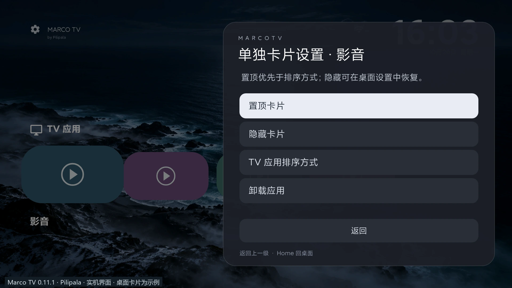

0.11.1 历史界面 · 单张卡片的置顶、隐藏、排序与卸载入口。

## 6｜名称、封面与收藏

让每张卡片适合自己的使用习惯。

**入口：** 长按卡片 → 重命名 / 更换封面 / 加入收藏。

- 重命名只改变桌面显示名称，最多 32 个字符。
- 使用原始图标或横幅、本地图片，或四种纯色封面。
- 恢复默认外观可清除该卡片的自定义名称与封面。

**适用条件：** 本地封面居中裁剪为 16:9 并复制到应用；不支持视频封面或手动调整裁切位置。部分导入流程使用系统文件选择器。

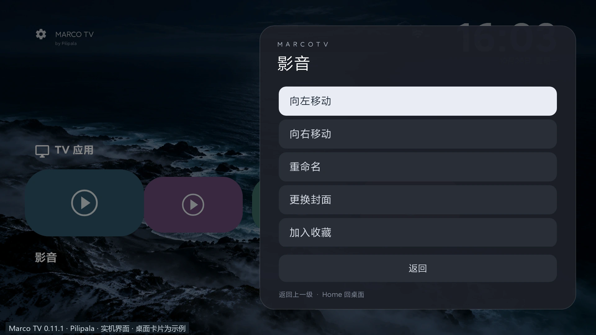

0.11.1 历史界面 · 长按卡片后的编辑菜单。

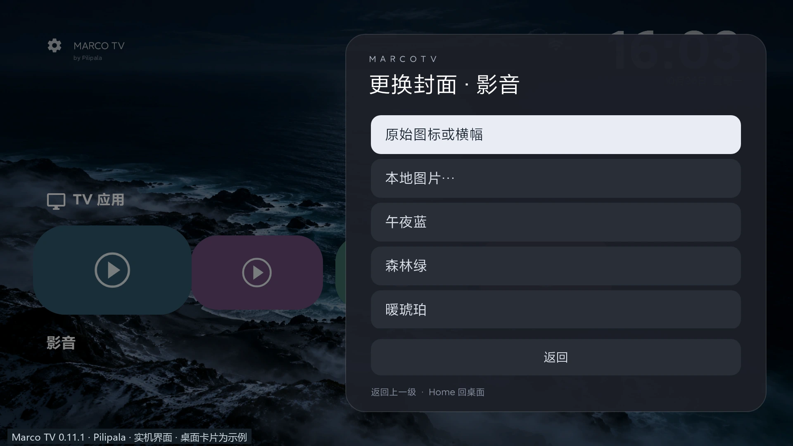

0.11.1 历史界面 · 原始封面、本地图片与纯色选项。

## 7｜排序与拿起移动

默认把最近从桌面打开的应用放在前面，也支持手动编排。

**入口：** 单独卡片设置 → TV 应用排序方式；长按 → 拿起并移动卡片。

- 可选上次打开、首字母、纯自定义三种排序。
- 拿起后左右移动，确定保存，返回或 Home 取消未确认移动。
- 中文按拼音参与首字母排序，改名后的名称也参与比较。

**适用条件：** 所有模式都优先显示置顶卡片；普通组不能越过置顶组。上次打开指从 Marco TV 启动的记录，不是全系统使用历史。

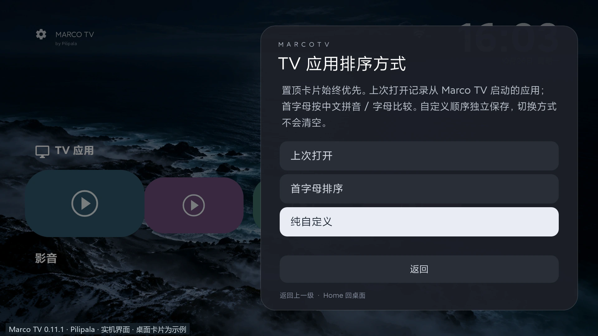

0.11.1 历史界面 · 三种排序方式。

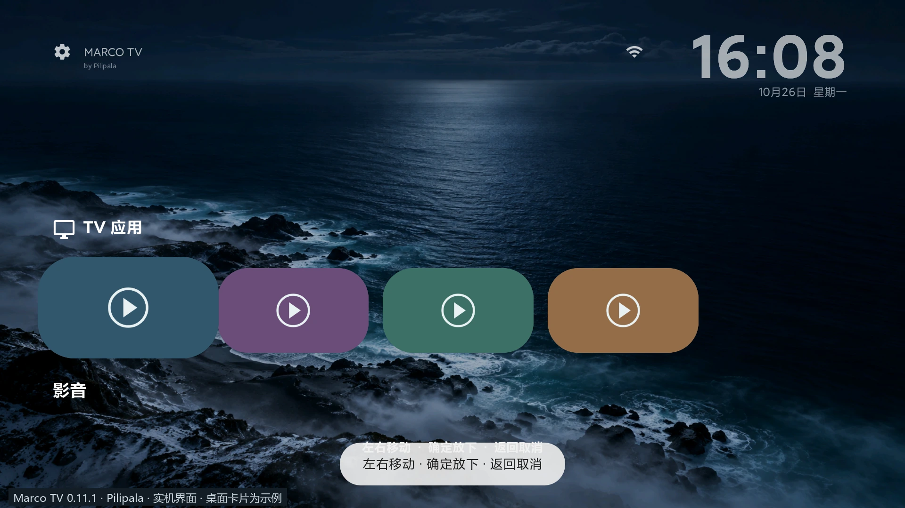

0.11.1 历史界面 · 拿起并移动：屏幕显示操作提示。

## 8｜Magic Desktop · 实时预览

左侧看放大的 3D 桌面，右侧集中调整 20 项参数。

**入口：** 首页 → Marco 互联旁的 Magic Desktop。

- 上下选择参数，左右微调，长按加速。
- 完整桌面在左侧侧倾，平滑边缘与圆角；右侧窄面板显示当前数值。
- 保存统一提交草稿；取消、返回或 Home 放弃未保存参数。「默认值」重置全部 20 项草稿。

**适用条件：** 数值按最小单位连续调节。壁纸选择、导入和屏保开关是立即生效的单独操作，不随数值草稿撤销。

0.14.0 · 完整桌面缩小并侧倾 · 右侧参数调整

## 9｜四张壁纸与本地导入

雾蓝海岸、暖沙丘、极夜山脊与峡谷，也可以用自己的图片。

**入口：** 首页 → Magic Desktop → 壁纸 → 选择或导入壁纸。

- 选择内置壁纸立即应用。
- 导入本地图片，复制到应用内部后不依赖原文件。
- 用壁纸亮度调整背景压暗程度，给卡片和文字留出对比度。

**适用条件：** 图片按屏幕比例居中覆盖，边缘可能裁切；亮度控制不改变电视背光。卸载或清除数据会删除内部导入图片。

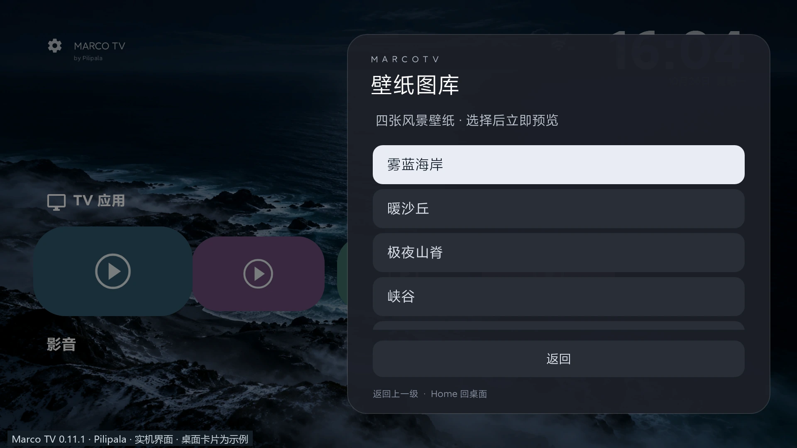

0.11.1 历史界面 · 内置壁纸图库。

雾蓝海岸 · 内置生成壁纸

暖沙丘 · 内置生成壁纸

极夜山脊 · 内置生成壁纸

峡谷 · 内置生成壁纸

## 10｜时间与日期

粗体时钟放在右上角，日期紧随其下。

**入口：** 首页 → Magic Desktop → 时间与屏保 → 桌面时间大小。

- 调整桌面时钟字号，实时查看与卡片的比例。
- 日期保持独立固定字号，避免随时间一起过度放大。

**适用条件：** 时间与时区来自电视系统；显示不准时应先校准系统时间。

0.14.0 · Magic Desktop · 时间与屏保参数

## 11｜放大时钟屏保

闲置后放大并提亮时间，同时压暗壁纸。

**入口：** 首页 → Magic Desktop → 时间与屏保。

- 设置等待时间、屏保时间大小、数字亮度、背景暗度和渐变时长。
- 聚焦屏保参数预览对应场景，修改渐变时长重播过渡；开关与系统接管在单独入口。
- 等待时间设为 0 时不自动进入。

**适用条件：** 这是桌面时钟画面，不是关闭背光；厂商屏保与节能策略可能优先，需结合 Home 兼容和系统设置实测。

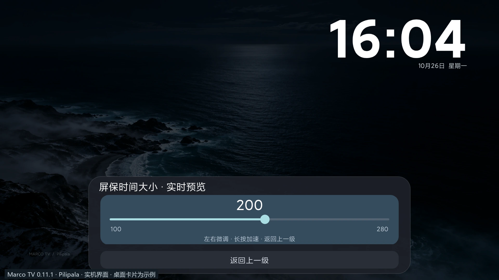

0.11.1 历史界面 · 屏保字号滑块与实时预览。

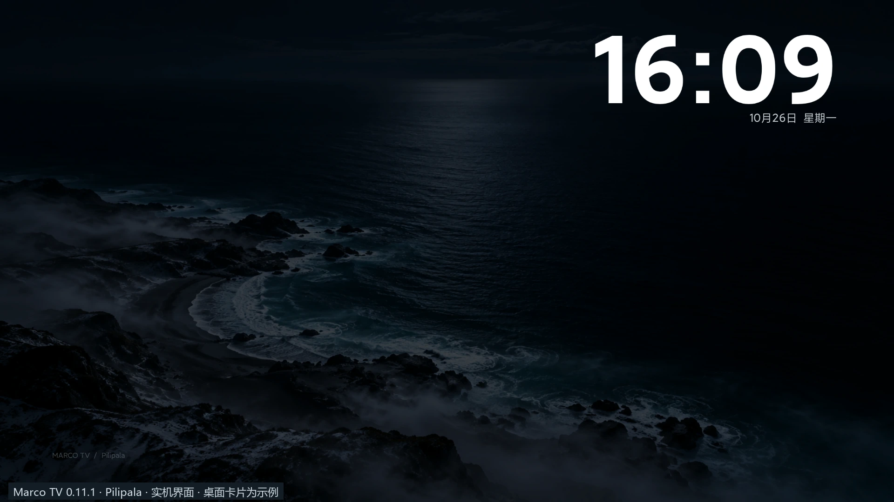

0.11.1 历史界面 · 进入屏保后的时间与压暗背景。

## 12｜设置导航与顺序调整

设置在同一右侧面板原位切换，返回恢复刚刚选中的项目。

**入口：** 左上齿轮或菜单键打开设置。

- 子菜单按返回回上一级，设置首页再按返回回桌面。
- Home 生效时可从任意设置层级直接回桌面。
- 在支持排序的列表中长按确定，上下调整，确定放下。

**适用条件：** 支持排序的固定设置列表可长按调整；Magic Desktop 滑块按功能分区，暂不支持重新排序。系统授权、输入法与文件选择器仍由系统提供。

0.14.0 · 一级设置

0.14.0 · 子页原位切换

0.14.0 · 逐级返回并恢复焦点

## 13｜网络与 Wi-Fi

热点名称搭配信号图标，减少不必要的信息堆叠。

**入口：** 右上 Wi-Fi 图标，或设备设置 → 网络与 Wi-Fi。

- 气泡显示绿色／灰色胶囊开关与最多四个附近网络，更多设置中可刷新和查看全部网络。
- 选择网络进行连接，查看连接详情。
- 每行显示名称、信号与连接状态，详情在选择后查看。

**适用条件：** 扫描和连接能力受 Android 版本、权限及厂商限制；新版展示使用示例网络，没有公开家庭 SSID 或地址。

0.14.0 · Wi-Fi 小气泡 · 名称与信号 · 示例网络

## 14｜音量与设备信息

常用设备设置放进统一界面，反馈问题时容易核对版本。

**入口：** 设置 → 设备设置。

- 使用音量滑块调整系统媒体音量。
- 查看电视品牌型号、Android 版本、Marco TV 版本与作者。

**适用条件：** 外接音响、HDMI 音量联动等行为由系统和设备决定；设备信息不等于对同品牌全部型号的适配承诺。

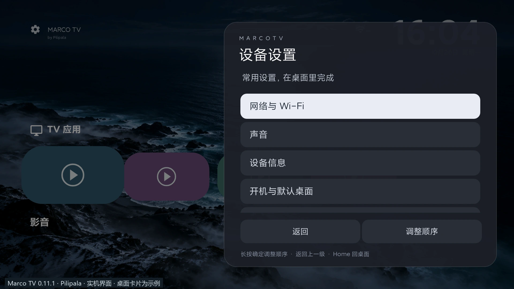

0.11.1 历史界面 · 设备设置总览。

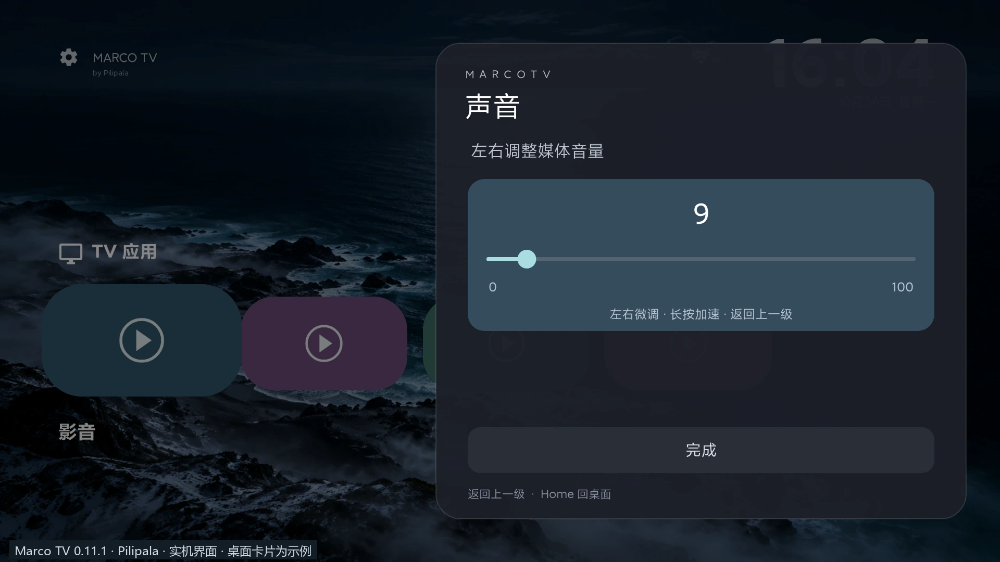

0.11.1 历史界面 · 音量滑块。

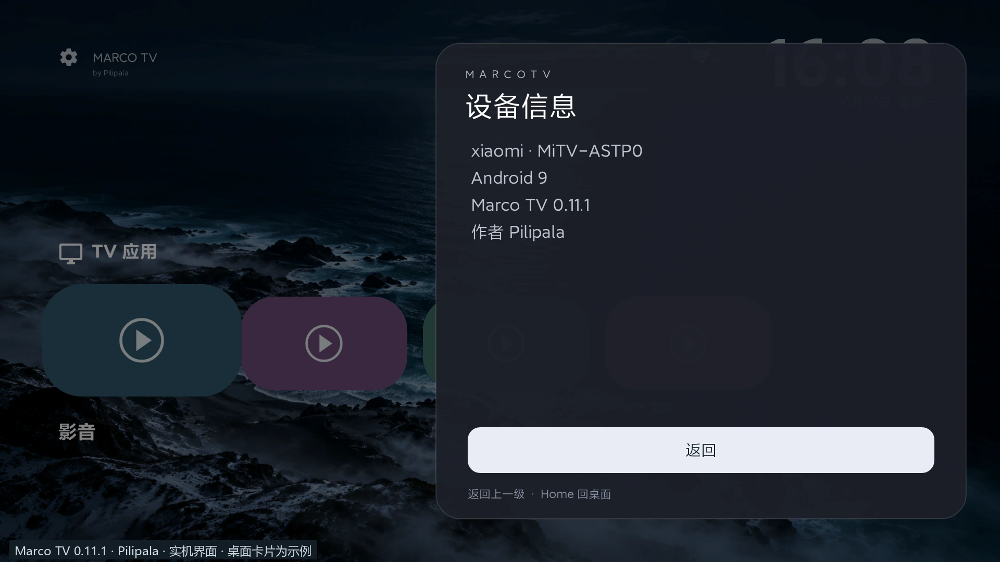

0.11.1 历史界面 · 品牌、型号、系统及软件版本。

## 15｜桌面正在播放卡片

回到桌面时，仍能看到播放器提供的标题、封面和状态。

**入口：** 设备设置 → 正在播放卡片 → 允许通知使用权。

- 播放器提供媒体会话时，左上出现播放卡片。
- 桌面按上键进入卡片，确定打开控制菜单。
- 没有封面时使用播放器图标。

**适用条件：** 图中为无音频的临时演示会话；软件不提供片源。没有系统媒体会话时不伪造播放卡片，不读取普通通知内容。

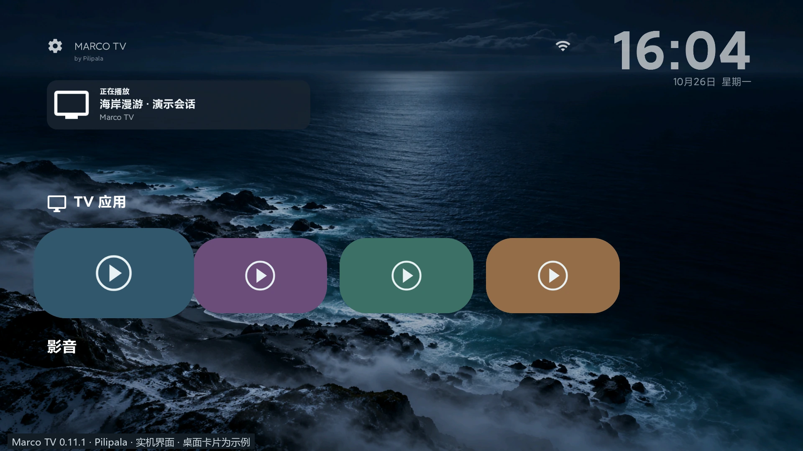

0.11.1 历史界面 · 左上播放卡片：标题明确标注为演示会话。

## 16｜播放控制与来源选择

有多个播放器时自己选择展示来源，也能临时收起卡片。

**入口：** 播放卡片 → 确定；设备设置 → 正在播放卡片。

- 返回播放应用，或在播放器支持时暂停、继续。
- 自动模式优先正在播放，也可手动选择来源。
- 暂时隐藏不会停止播放；可从设置恢复。

**适用条件：** 控制能力取决于播放器。来源选择与临时隐藏只保留在本次进程；暂停会话观察满 30 分钟后收起，不记录观看历史。

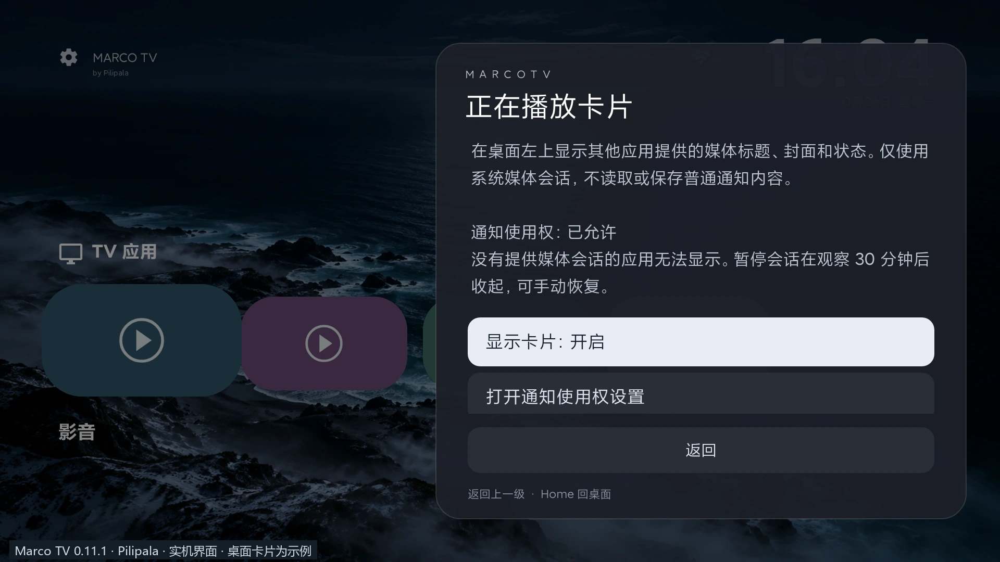

0.11.1 历史界面 · 播放卡片与权限设置。

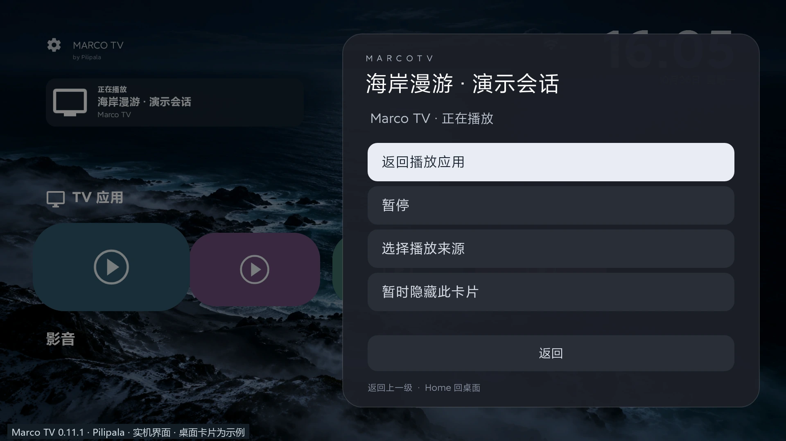

0.11.1 历史界面 · 演示会话的控制菜单。

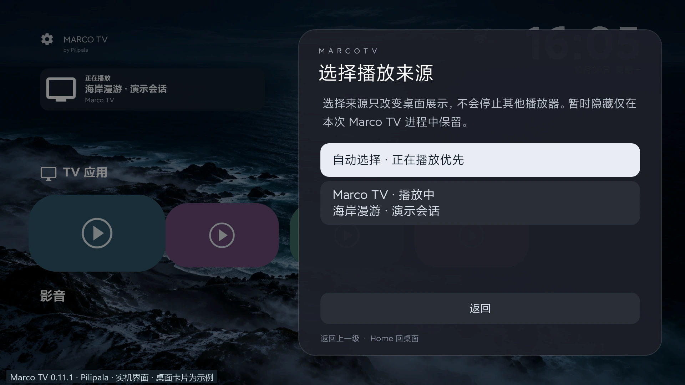

0.11.1 历史界面 · 自动选择或指定播放来源。

## 17｜系统最近任务

堆叠卡片返回上次页面，支持清除单个系统任务。

**入口：** 先按安装说明启动电脑辅助服务，再开启双击 Home。

- 单击 Home 回桌面，快速双击进入最近任务。
- 左右选择，确定回到任务；遥控器上键或上滑清除所选任务。
- 任务卡片从底部聚拢位置上移并展开，背景同步压暗。

**适用条件：** 读取系统任务而非全部进程。清除只在系统与窗口栈支持时执行，不是清内存工具。优先系统缩略图，本次实测电视不提供缩略图，使用 Logo；名称和图标已遮挡。

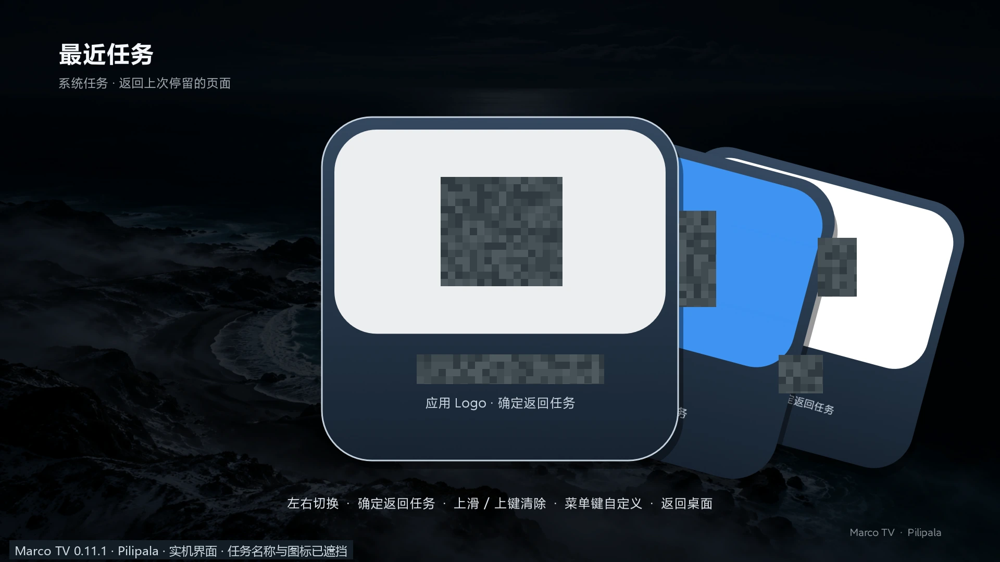

0.11.1 历史界面 · 系统任务堆叠；应用名称与图标已遮挡，保留原卡片布局。

## 18｜最近任务外观与交互

把卡片大小、倾斜和动画调到适合屏幕与遥控器的程度。

**入口：** 首页 → Magic Desktop → 最近任务卡片；也可从最近任务设置跳转。

- 集中调整大小、间距、倾斜、圆角、背景暗度、动画时长、显示数量及 Home 双击间隔。
- 保存后生效；返回、取消或 Home 撤销本次参数。

**适用条件：** 预览读取真实任务状态；辅助服务未连接或没有任务时显示相应提示。调整参数不会清除任务，也不会自动获取系统权限。

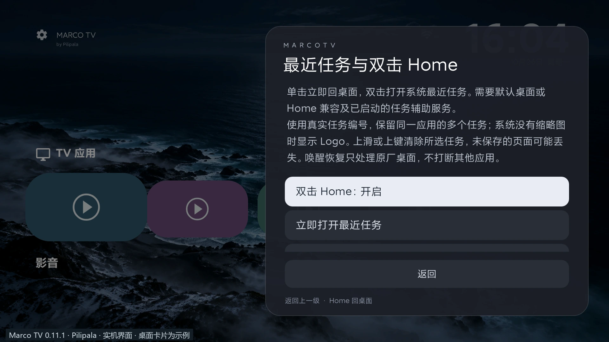

0.11.1 历史界面 · 双击 Home 与系统任务功能入口。

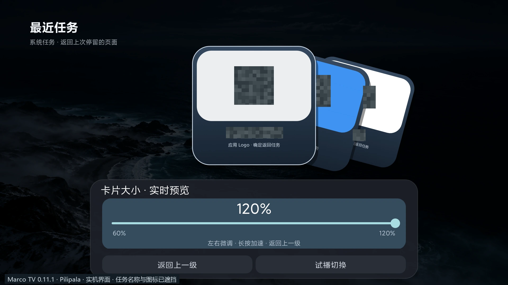

0.11.1 历史界面 · 卡片大小预览，任务信息已遮挡。

## 19｜默认桌面、Home 与开机恢复

按电视能力选择接管方式，并把状态留在界面里。

**入口：** 设置 → 开机与默认桌面。

- 设为默认桌面，必要时开启 Home 兼容。
- 选择开机打开、唤醒恢复以及 ADB 调试开关恢复。
- 高级自动恢复按安装说明完成一次系统设置授权，再用实体遥控器验证。

**适用条件：** 普通 APK 不能保证重启后打开所有品牌的网络 ADB 端口，也不能保证所有固件的 Home 接管。初装保留原厂桌面，先完成返回与撤销验证。

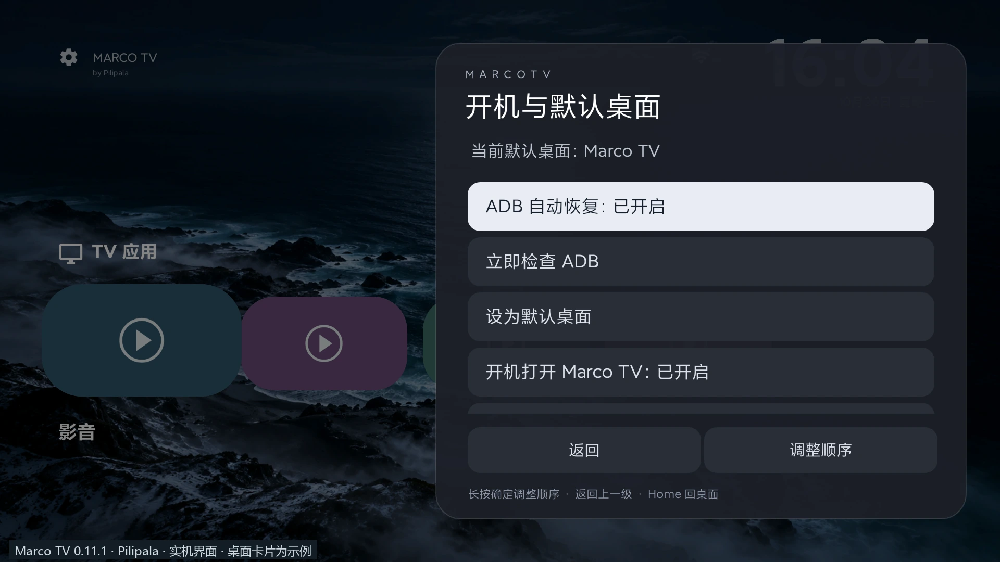

0.11.1 历史界面 · 开机、默认桌面和恢复选项。

## 20｜首次启动引导

先试用桌面，再按需要开启系统能力。

**入口：** 首次全新安装；设置 → 设置状态与引导可重新查看。

- 五步引导逐项说明试用与配置。
- 可以随时跳过，之后再继续。
- 覆盖升级保留配置，不强制重新走一遍。

**适用条件：** 完成引导不等于设备权限已全部授予；以状态页和实际操作为准。

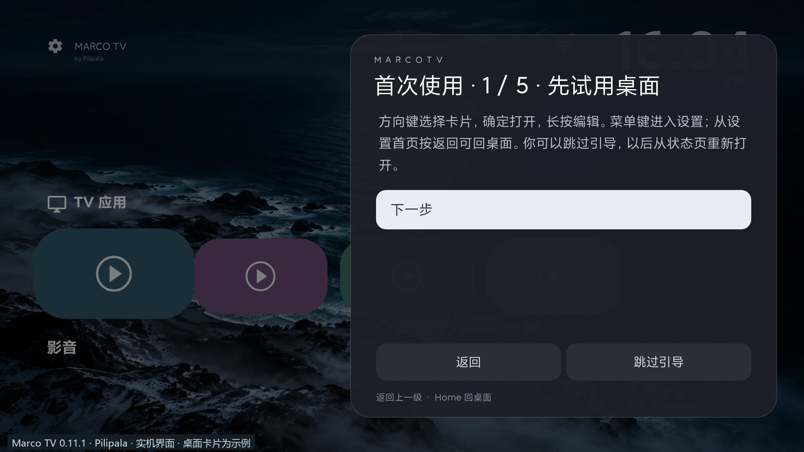

0.11.1 历史界面 · 首次引导第 1 步：先试用桌面。

## 21｜统一状态检查

把默认桌面、权限、服务和播放状态集中在同一处。

**入口：** 设置 → 设置状态与引导 → 状态检查。

- 查看默认桌面、Home 服务、开机开关、ADB 恢复和播放授权。
- 重新检查只刷新状态，不自动修改系统配置。
- 按页面提示分别验证实体 Home、待机、重启与断电恢复。

**适用条件：** 状态截图仅演示字段，不作为长期稳定运行证明；检查记录和存储数值已遮挡。

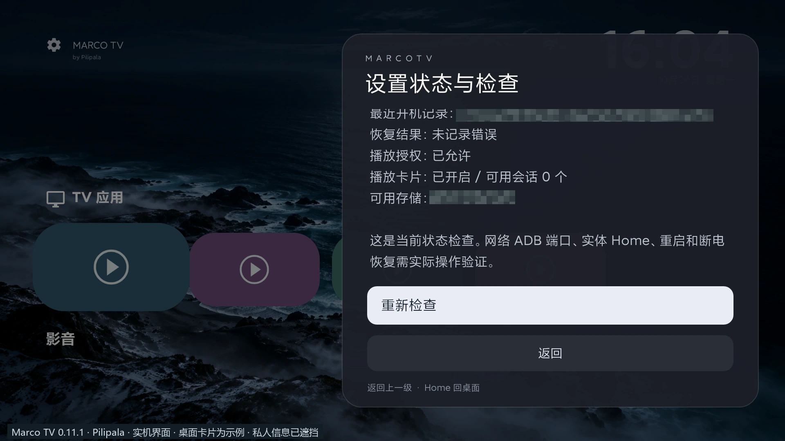

0.11.1 历史界面 · 状态页下半部分：恢复、播放与重新检查。

## 22｜本地备份与恢复

把外观和卡片配置带走，恢复前先看会改变什么。

**入口：** 设置 → 备份与恢复。

- 仅设置或设置与图片两种导出；最近 3 份启动后首次进入设置前的自动快照循环保留。
- 选 ZIP 后查看来源版本、图片数和未安装应用数，再确认恢复。
- 恢复前保存原配置，遇到失败尝试回退；重要备份应复制到 U 盘或电脑。

**适用条件：** 本版没有云端同步。备份不含 APK、账号密码或系统权限，但包含私人应用配置和自选图片，不能直接公开。图中只展示恢复预览，未执行恢复。

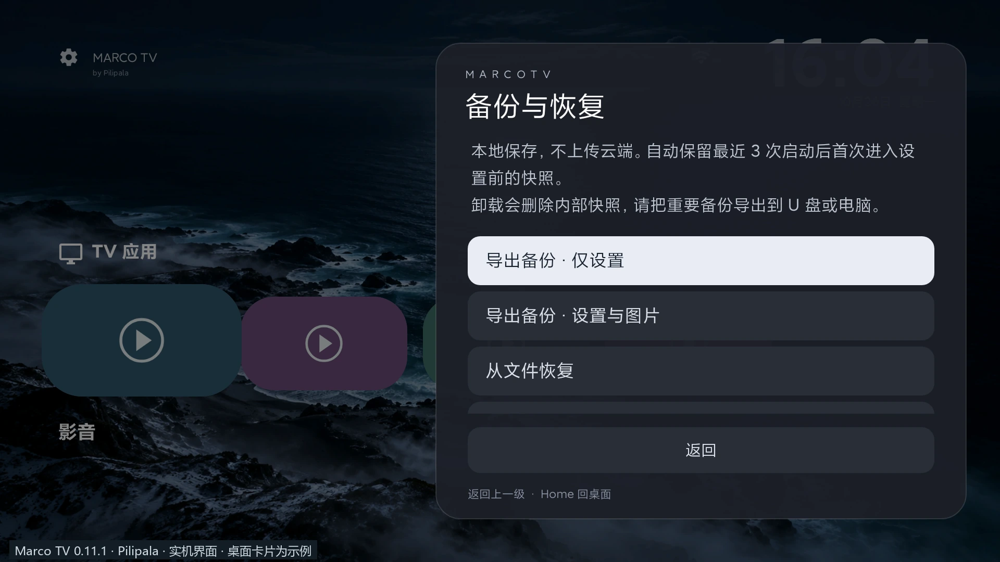

0.11.1 历史界面 · 本地备份、导出与恢复入口。

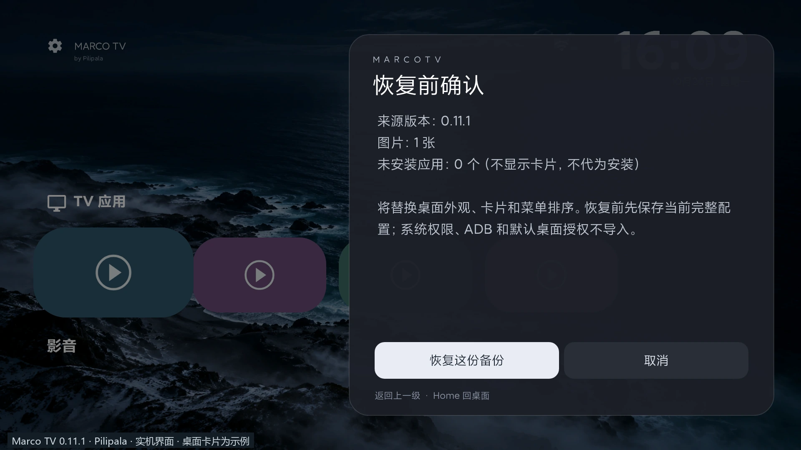

0.11.1 历史界面 · 恢复前确认影响范围。

## 23｜本地诊断与异常线索

遇到异常时先检查、预览报告，再决定是否分享。

**入口：** 设置 → 本地诊断。

- 默认自动记录本应用异常和关键操作线索，本地最多保留 7 天、5 MB。
- 查看状态和报告，手动导出；可关闭自动记录或清除已有记录。
- 反馈时附品牌型号、系统版本、操作步骤和经过确认的报告。

**适用条件：** 不自动上传或代发 GitHub 问题。断电、系统结束进程可能没有完整原因；疑似无响应不等于系统确认的 ANR。公开截图已遮挡检查时间。

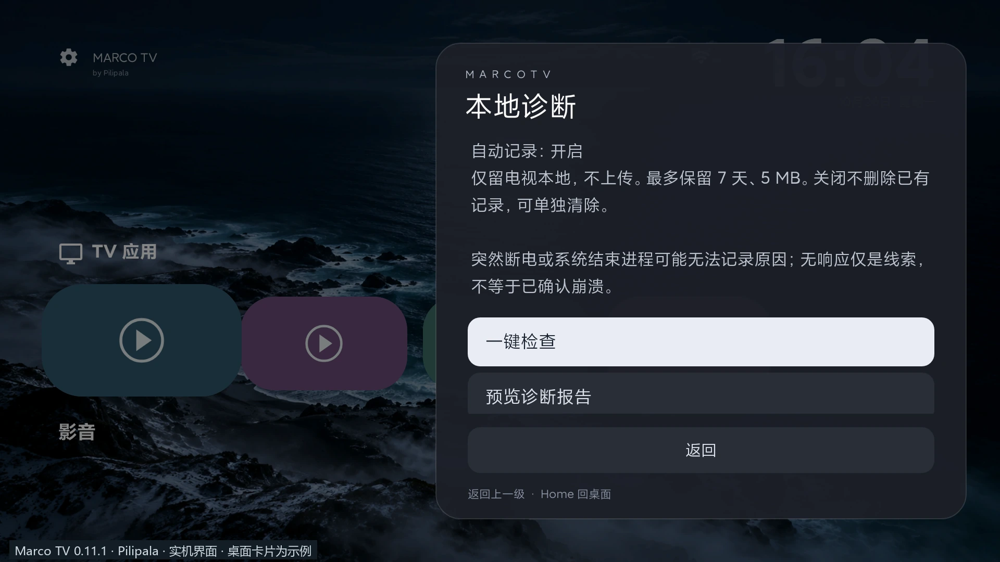

0.11.1 历史界面 · 本地诊断开关与检查入口。

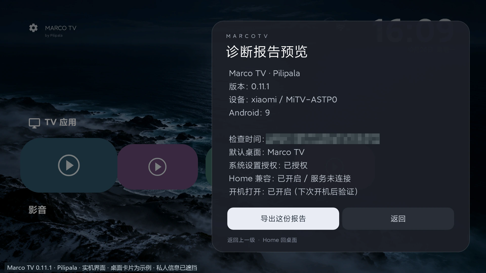

0.11.1 历史界面 · 报告预览与手动导出；这是界面示例，不是设备验收报告。

## 24｜Pilipala · 免费开源

Marco TV 免费发行，没有会员、激活码或购买入口。

**入口：** 设置 → 关于 Marco TV；GitHub 查看源码与版本。

- 从 GitHub Releases 下载作者发布的安装包。
- 查看安装、使用、品牌入口、隐私与构建说明。
- 按 GPL-3.0-only 保留许可与署名，修改分发时提供对应源码。

**适用条件：** 如果你付费购买了本软件，请尽快向购买平台申请退款。免费发行提示不改变 GPL 允许的权利；第三方资源保留其自身许可。

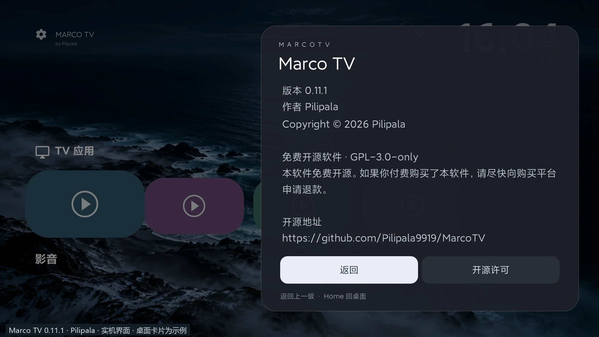

0.11.1 历史界面 · 软件版本、作者、开源协议与退款提示。

## 安装、使用与兼容性

最低 Android 6.0 / API 23；当前实测 Xiaomi MiTV-ASTP0、Android 9。其他机型需分别验证应用安装、Home、屏保、网络与后台服务。Tizen、webOS、tvOS 等系统不支持直接安装此 APK。

1. [安装说明](安装说明.md)：核实品牌与系统、开发者模式、未知来源、ADB、安装授权、默认桌面与撤销。
2. [各品牌电视设置入口](各品牌电视设置入口.md)：按实际系统及固件核对开关位置。
3. [详细使用说明](使用说明.md)：完整按键表、参数范围与故障处理。
4. [常见问题](常见问题.md) · [隐私说明](隐私说明.md) · [验证范围](验证范围.md) · [构建说明](构建说明.md)

## 展示素材使用

本页文字、展示页面与内置生成壁纸由 Pilipala 按 GPL-3.0-only 发布；第三方资源遵循 [NOTICE](../NOTICE)。转载图片请保留署名、示例数据说明和隐私遮挡，不应将被遮挡的任务内容推断成推荐应用。

Copyright © 2026 Pilipala.
