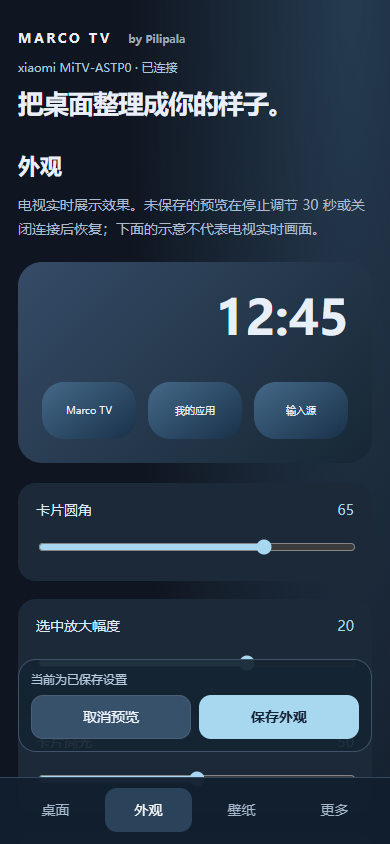

# Marco 互联 · 手机与电视

作者：Pilipala · 0.14.0 正式版 · 2026-10-29

无需安装手机 App。电视和手机连接同一家庭局域网，即可用浏览器整理桌面。此功能不需要 ADB；不提供全局遥控、云端控制或投屏。

图为 Edge 浏览器 390 像素视口连接真实电视的界面，并非实体手机截图；画面未展示私人应用、网络地址或配对码。

## 连接

1. 电视在桌面顶部选择「Marco 互联」，或进入「设置 → Marco 互联」，显示二维码。
2. 手机连接同一 Wi-Fi，扫描二维码，用系统浏览器打开。电视连接有线网络也可以，但路由器不能隔离两端。
3. 在电视出现的提示中选择「允许连接」，手机才可读取和修改桌面。
4. 无法扫码时，在浏览器输入二维码页「手动连接」显示的完整地址，再输入连接码。二维码 5 分钟有效，过期后在电视重新显示。

每次只配对一个浏览器会话，换手机先断开再开启。二维码含临时凭据，不要公开分享。服务仅供可信局域网使用，HTTP 本身不加密，不要映射到公网。

## 桌面页

- 按住卡片左上角手柄拖动排序；也可点手柄选择向前／向后移动。
- 点卡片修改名称、置顶或隐藏；隐藏后可在「已隐藏的卡片」恢复。
- TV 应用支持上次打开、首字母、纯自定义排序；手动调整会切换到自定义。置顶卡片必须排在普通卡片前。
- 「添加应用」列出电视已安装应用，选择应用后再选公开启动入口。权限受限、停用或未公开的页面不能强行添加。
- 这类操作即刻保存。电视同时编辑导致列表变化时，手机会提示刷新，避免旧列表覆盖新设置。

## 外观页

滑块调整圆角、选中放大、高光、名称亮度、桌面／屏保时钟、背景压暗与动效速度。手机图为布局示意，实际效果以电视为准。

拖动只修改内存中的预览，点「保存外观」才写入配置。「取消预览」、停止调节 30 秒、离开桌面或断开连接都会恢复未保存的部分。电视端修改配置时也会取消手机预览。

调节屏保相关滑块时，电视直接展示放大时间及压暗背景；调整桌面参数或取消预览后恢复桌面。

## 壁纸页

可切换内置壁纸，或选择手机中的 JPEG、PNG、WebP。上传前调整放大倍数、水平与垂直位置；以 16:9 裁切并转换为 JPEG 后传到电视。

图片上限 16 MB、3200 万像素，电视端也会再次检查尺寸。上传中断不会应用不完整图片；看到「已应用到电视」才表示成功。HEIC 等未支持格式可先在相册导出为 JPEG。

## 备份、恢复与诊断

- 「下载完整备份」保存配置及自定义图片到手机浏览器的下载位置。含私人信息，请妥善保管，不要直接作为故障报告公开。
- 选择 Marco TV 备份 ZIP 上传，最大 128 MB；电视校验后显示来源和内容摘要，需要在电视再次确认才恢复。恢复前保存原配置，系统授权和 ADB 不导入。
- 「预览脱敏诊断」先展示报告，再由用户下载。报告包含品牌型号、版本与故障代码，不包含 Wi-Fi 密码、媒体标题或完整应用清单。

## 断开与故障处理

手机「更多 → 退出本次连接」或电视「Marco 互联 → 断开并关闭 Marco 互联」可关闭服务。15 分钟未操作也会自动关闭；仅打开页面轮询不会续期。

连不上时检查：是否同一局域网、是否访客网络／AP 隔离、是否有 VPN、电视是否待机、IP 是否改变。地址改变后在电视重新开启。微信等内置浏览器可能限制本地网页或文件下载，可改用系统浏览器。

本版已经在小米 Android 9 和桌面 Edge 浏览器的手机尺寸视口验证。iPhone Safari、安卓各品牌浏览器、TCL 及其他电视仍需实际设备反馈，不能据此保证全部兼容。

本软件免费开源。如果你付费购买了本软件，请尽快申请退款。更多见[隐私说明](隐私说明.md)。

## 0.13.0 的连接与预览

电视二维码采用居中双栏：左边扫码，右边连接步骤和本地功能；连接码收进「手动连接」页面。配对后桌面入口有连接状态点，关闭服务后熄灭。

电视端正在调节外观时，手机不能覆盖该预览。先在电视保存或取消，再继续手机调节。电视的「默认值」仅重置当前预览，保存后才生效；返回和 Home 都撤销未保存部分。

## 后续路线（尚未实现）

- 下一阶段：先评估手机文字输入、桌面快捷操作和播放控制；分别检查电视授权与媒体会话能力。
- 跨应用全局遥控、完整最近任务操作、APK 安装，需要相应系统权限和可用接口，不随扫码自动获得。
- 远程公网控制、云端账户和投屏不在本次版本范围；保持无账号、同一局域网、电视确认的连接方式。

上面的第一阶段功能已提供；此路线不是未实现功能的可用承诺。
