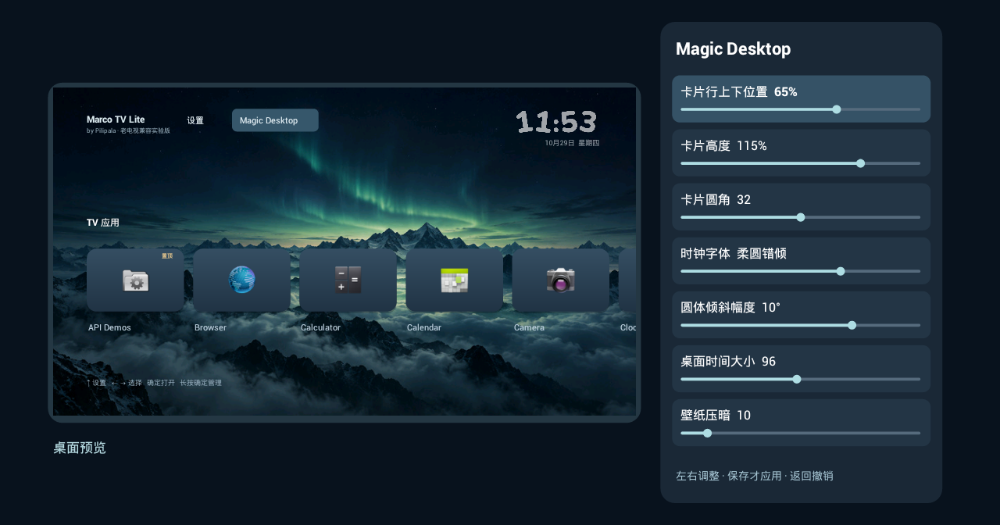
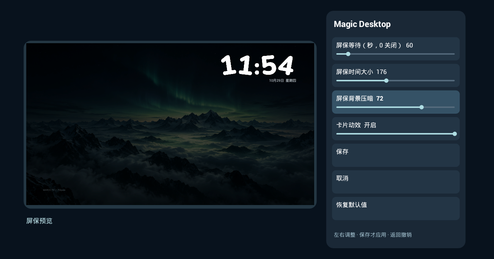
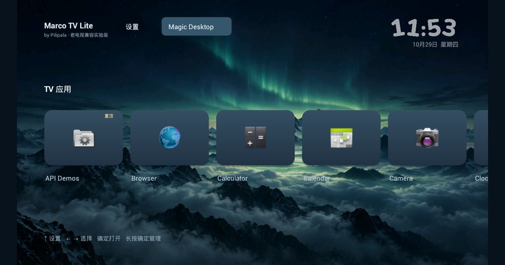
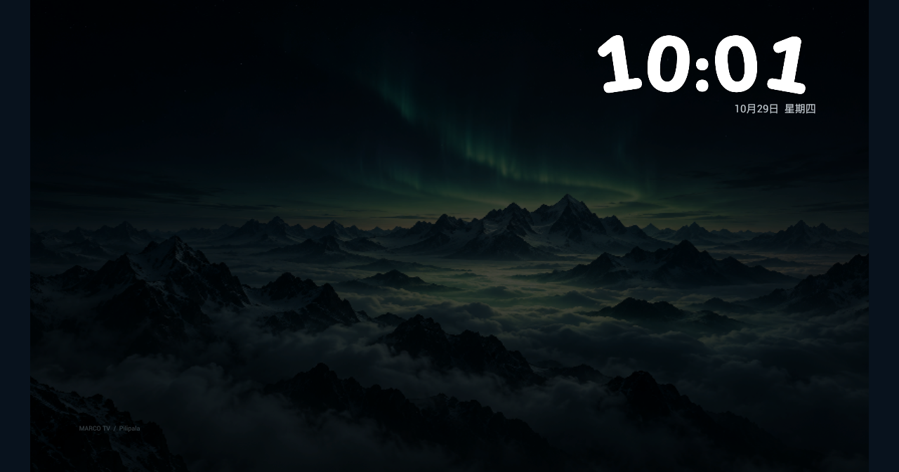

# Marco TV Lite

作者 **Pilipala** · **0.2.0 老电视兼容实验版** · [GPL-3.0-only](../LICENSE)

**本软件免费开源。如果你付费购买了本软件，请尽快向购买平台申请退款。**

面向 Android 4.0 起步的轻量桌面，独立于完整版安装和维护。本版继续使用真正的 Android API 14 桩库编译（Dalvik `dex 035`），无联网权限、无后台服务，在保持约 **321 KiB** 极简体积的前提下，同步了完整版可兼容的桌面交互、卡片自定义与应用管理/卸载能力。**尚无 Android 4.x / 5.1 老电视与小米盒子 3c 真机实测验证，暂作为实验版招募反馈。**

## 0.2.0 更新

- **完整应用管理与系统确认卸载**：
  - 顶栏右侧与「设置 → 全部应用与管理」新增 **「全部应用与管理」** 集中管理页：列出全部已识别应用（含已隐藏与系统应用），展示应用图标、版本、包名及 `[置顶]` / `[已隐藏]` / `[系统]` / `[自定义尺寸]` 标签，方向键上下浏览、左右快速翻页，按确定进入单应用管理。
  - 长按桌面卡片（或在「全部应用与管理」中按确定）升级支持：**置顶到首位 / 取消置顶**（多排序模式下均遵守置顶先后顺序）、**隐藏 / 取消隐藏**、**卸载应用（系统确认）**（调用原生 `ACTION_DELETE` 打开系统卸载确认页，系统内置应用给出友好提示并可转到系统应用信息）、**重命名应用**（最多 32 字，支持恢复原名）、**向左 / 向右移动**（支持「最近打开 / 首字母 / 自定义」三种排序）、**自定义卡片尺寸**、**系统应用信息** 与 **打开应用**。
  - 清单仅新增非特权、非联网的普通权限 `android.permission.REQUEST_DELETE_PACKAGES`（Android 4.0–8.1 自动忽略，Android 9+ `targetSdk=28` 调起系统卸载弹窗所必需），仍保持零联网权限、零存储权限、零后台服务。
- **同步完整版兼容特性（纯 API 14 原生实现）**：
  - **顶栏精简与三图标弹簧动效**：移除首页左上角冗余副标题，顶栏重绘为 `MARCO TV`、`Magic Desktop`、`全部应用` 3 枚纯 Canvas 矢量图标并接入 `MotionSpring` 焦点动画（关闭「卡片动效」时自动静止零重绘）。
  - **卡片视觉与尺寸自定义**：主行标题统一更名为「我的应用」并扩大卡片行向下移动范围；卡片升级平滑三段光学玻璃渐变、柔和双层悬浮阴影与亮白焦点描边；Magic Desktop 新增全局 **「卡片宽度」**（`70–140%`）、**「卡片立体厚度」**（`0–100%`）与 **「闲置纯净壁纸」**（复用共享 `ClockScene`）；长按任意卡片支持独立 **「自定义卡片尺寸」**（宽 / 高 / 立体厚度 / 圆角 + 实时桌面预览）。
  - **本地壁纸与默认桌面入口**：设置菜单新增免存储权限的 **「导入本地壁纸」**（通过 `ACTION_GET_CONTENT` 选取图片并安全降采样至 720p `RGB_565` 缓存至应用内部）以及 **「设为默认桌面」** 快捷入口。
- **针对小米盒子 3c（Android 5.1）等老设备的安装兼容修复**：
  - 将旧版无固有尺寸的 XML 图标（`res/drawable/app_icon.xml`）替换为 4 套标准多密度 PNG 图标（`mdpi / hdpi / xhdpi / xxhdpi`），补全 `android.software.leanback` 非必需声明与 `@string/app_name`，并规范 `build_lite.py` 的 ZIP 头提取版本与 `D8 --release` 字节码打包。
  - 新增可选的无 `HOME` 声明受限兼容包 `MarcoTV-Lite-0.2.0-Restricted.apk`，供固件拦截第三方桌面安装的设备（如部分小米盒子 3c / TCL 系统）尝试。

## 完整版特性兼容说明（哪些已同步 / 哪些不适合 Lite）

| 能力 | Lite 0.2.0 状态 | 说明 |
| --- | --- | --- |
| 顶栏去副标题 + 矢量弹簧焦点动效 | **已兼容** | 3 枚纯 Canvas 矢量图标，关闭动效时零重绘 |
| 全部应用管理 + 卸载 / 重命名 / 置顶到首位 / 自定义排序 | **已兼容** | 原生 `ACTION_DELETE` 系统确认卸载 + 集中应用管理页 |
| 卡片行扩大下移范围 + 全局/单卡长宽高与 3D 厚度 | **已兼容** | 纯 2D Canvas 轻量绘制，支持混排宽度与实时预览 |
| Apple TV 风格平滑玻璃卡片质感 | **已兼容** | 3 段缓存渐变 + 轻阴影，避免老 GPU 卡顿 |
| 闲置纯净壁纸模式 + 四款时钟字体与防烧屏漂移 | **已兼容** | 直接复用共享 `ClockScene.java` |
| 本地图片壁纸导入（免存储权限） | **已兼容** | 走系统 `ACTION_GET_CONTENT`，自动降采样至 720p |
| 云端 4K 60fps 动态视频壁纸 / 扫码传图 / Marco 互联 / DLNA 投屏 / 在线更新 | **不适合 Lite** | 需要联网权限、后台线程或硬件 HEVC 解码器，违背 Lite 无联网/低内存/300 KiB 定位 |
| 系统最近任务 / 正在播放卡片 / Home 键无障碍兼容 / 系统屏保 | **不适合 Lite** | 依赖 API 17–21+ 系统服务或后台常驻服务，Android 4.0 原生不存在 |
| GPU 3D 透视舞台与高斯模糊阴影 | **不适合 Lite** | 依赖 API 21 `ViewOutlineProvider` 与较强 GPU，Lite 保持高效平面预览 |

## 0.1.2 修复（历史记录）

- 恢复写入失败时报告未完成，不再提示成功；尝试还原恢复前配置，不对失败后的持久化状态作保证。
- 暂时离开页面保留导航位置和未保存草稿；返回、取消和 Home 仍可撤销草稿。通过系统提供的页面重建状态恢复草稿与返回路径。
- 时区变化后更新已有时钟，接收系统时间／时区变化并重新安排刷新。

## 版本怎么选

| 项目 | Marco TV 完整版 0.20.0 | Marco TV Lite 0.2.0 |
| --- | --- | --- |
| 最低系统声明 | Android 6.0 / API 23 | Android 4.0 / API 14，实验支持 |
| 应用包名 | com.pilipala.tvhome | com.pilipala.tvhome.lite |
| 基础桌面与管理 | 多分组卡片、收藏、输入源、扫码换封面 | 单行「我的应用」、全部应用管理、置顶到首位、改名、排序、隐藏、系统确认卸载 |
| 卡片自定义 | 全局 + 单卡长宽高/厚度/圆角 + 扫码封面 | 全局 + 单卡长宽高/厚度/圆角 + 实时预览 |
| Magic Desktop | GPU 3D 预览与折叠即时保存 | 平面缩小预览、14 项调整、保存／撤销 |
| 时钟与壁纸 | 四款字体、云端 4K 动态壁纸、扫码导入 | 同款四种数字字体、两张内置壁纸 + 本地图片导入 + 闲置纯净壁纸 |
| Marco 互联、无线投屏、最近任务、正在播放 | 按系统权限提供 | 本版未提供 |
| 权限边界 | 局域网 / 更新 / 投屏按需申请 | **无联网权限、无后台服务**，仅声明 `REQUEST_DELETE_PACKAGES` 用于调起系统卸载确认 |
| 更新 | 完整版在线更新渠道 | 手动覆盖安装 Lite，不接入完整版更新渠道 |
| 备份 | 完整版备份机制 | 仅本机内部外观快照（兼容旧版 0.1.2 备份）；不与完整版互通 |

Lite 与完整版可以同时安装，设置分别保存。本版 APK 约 **321 KiB**（329,354 字节）；未申请联网权限，不上传使用数据。为控制开销，内置壁纸采用 836×470 JPEG，按设备应用堆内存预算解码最多 64 个应用图标，其余显示名称首字；仍会列出其余可启动应用。

## 安装与首次试用（含小米盒子 3c 提示「检测安装包异常」排查）

1. 在电视/盒子「关于／系统信息」核对实际 Android 版本。不是 Android 或不能安装 APK 的系统，不适用此版本。
2. 下载 **`MarcoTV-Lite-0.2.0.apk`**（若固件限制第三方桌面 `HOME` 声明，可尝试无 `HOME` 声明的 **`MarcoTV-Lite-0.2.0-Restricted.apk`**）。普通完整版 APK 不能用于 Android 4.x / 5.x。
3. 在电视中允许未知来源安装，通过 U 盘、浏览器、厂商文件接收或电脑 ADB 安装。
4. **若小米盒子 3c（Android 5.1）或小米电视在 U 盘安装时提示「检测安装包异常，无法安装」**：
   - 请务必使用 `0.2.0` 及以上版本（已修复旧版 XML 图标为标准多密度 PNG 并规范 ZIP 打包）；
   - 如仍被小米自带「高清播放器 / 应用安装器」拦截，通常是 MIUI TV 联网安全校验或第三方桌面拦截导致：请先开启「允许安装未知来源应用」，再**断开电视/盒子网络（关闭 Wi-Fi 或拔掉网线）后通过 U 盘安装**；
   - 或开启「允许 ADB 调试」后用电脑/手机通过 `adb install -r MarcoTV-Lite-0.2.0.apk` 安装；也可以试用无 `HOME` 声明的 `MarcoTV-Lite-0.2.0-Restricted.apk`。
5. 从原厂应用列表打开 **Marco TV Lite**，先检查卡片、应用启动、方向键、长按管理和返回键。
6. 如系统允许选择默认桌面，可在「设置 → 设为默认桌面」或系统设置中选择 Lite。恢复时从系统设置改回原厂默认桌面，或卸载 Lite。

开发者可用 `adb -s <设备序列号> install --no-streaming -r MarcoTV-Lite-0.2.0.apk` 安装。

## 遥控器与设置

- 左右选择卡片，确定打开应用；向右超过第二张后平滑滚动。
- 上键进入顶部 **「MARCO TV（设置）」「Magic Desktop」「全部应用」**，下键回卡片行。
- 长按确定打开单应用管理菜单：置顶到首位 / 取消置顶、隐藏 / 取消隐藏、卸载应用（系统确认）、重命名、向左 / 向右移动、自定义卡片尺寸、系统应用信息、打开应用。
- 进入「全部应用」可集中查看所有已识别与已隐藏应用，左右键快速翻页，按确定进入单应用管理或卸载。
- Magic Desktop 中上下选择，左右调整参数；滚动到底部选择「保存」「取消」「恢复默认值」。参数预览不立即写入设置，返回或 Home 丢弃草稿。单张卡片「自定义卡片尺寸」左右调整即时预览生效，并可一键恢复跟随全局默认。

### Magic Desktop 参数（14 项）

| 参数 | 可调范围 |
| --- | --- |
| 卡片行上下位置 | 0–100%（已扩大下移范围） |
| 卡片高度 | 70–130% |
| 卡片圆角 | 0–64 |
| 时钟字体 | 现代宽体、修长窄体、柔圆错倾、雅致衬线 |
| 圆体倾斜幅度 | 0–14° |
| 桌面时间大小 | 36–160 |
| 壁纸压暗 | 0–90 |
| 闲置等待 | 0–600 秒；0 为关闭，每次调整 10 秒 |
| 屏保时间大小 | 100–280 |
| 屏保压暗 | 0–100 |
| 卡片动效 | 开／关 |
| 卡片宽度 | 70–140% |
| 卡片立体厚度 | 0–100% |
| 闲置纯净壁纸 | 开／关（开启后屏保仅展示纯净壁纸） |

## 界面展示与验证范围

以下历史对比图为 **Android 4.0.2 模拟器中实际 View 绘制导出的图片**（`0.1.2` 基线），不是电视实拍，也不是帧率证明。









[完整验证记录](validation.json) 记录 `0.2.0` 的 APK 校验值、24 项本地检查（含 PNG 图标与规范 ZIP 头验证）、API 14 真实桩编译检查、小米 `MiTV-ASTP0`（Android 9）覆盖安装与界面截屏验证以及未验证范围。**Android 4.x / 5.1（含小米盒子 3c）老设备实体真机仍待反馈，欢迎通过 [GitHub Issues](https://github.com/Pilipala9919/MarcoTV/issues) 提交型号、系统版本和实测结果。**

## 从源码构建

需要完整仓库，包括完整版共享的时钟绘制、动画、偏好草稿和字体资产。使用 Python 3.10+：

```text
python scripts/bootstrap.py
python scripts/build.py
python scripts/bootstrap_lite.py
python scripts/build_lite.py
python scripts/build_lite.py --restricted
python scripts/test_lite.py
python scripts/check_release.py
```

产物为 `dist/MarcoTV-Lite-0.2.0.apk`、`dist/MarcoTV-Lite-0.2.0-Restricted.apk` 和同名 `.sha256` 文件。

## 开源说明

Lite 源码采用 [GPL-3.0-only](../LICENSE)，作者 Pilipala。共享代码及素材说明见 [NOTICE](../NOTICE) 与 [资产说明](../assets-notes.md)；内置壁纸压缩参数、原图与产物哈希见 [Lite 壁纸来源](src/main/assets/wallpapers/sources.json)。字体的来源、哈希与许可见 [字体来源](../app/src/main/assets/fonts/sources.json) 和 `licenses/*-OFL.txt`。应用「关于与开源许可」中按确定可查看随包许可全文。
