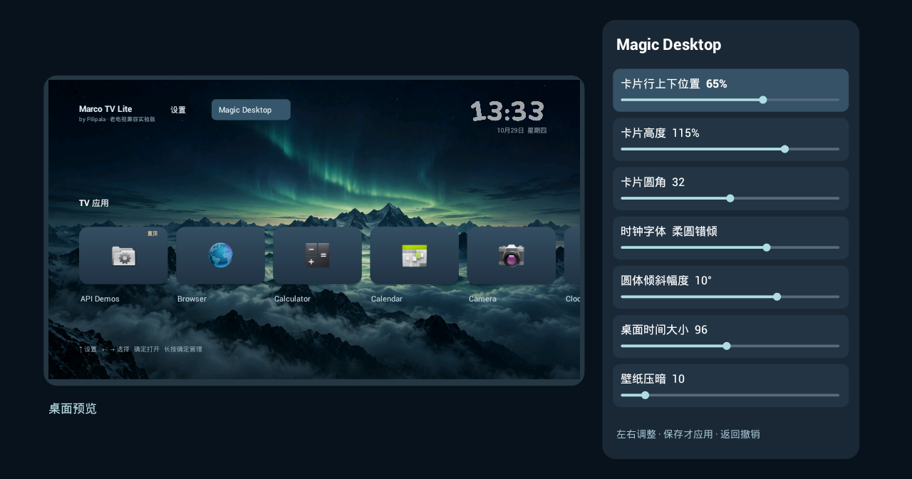
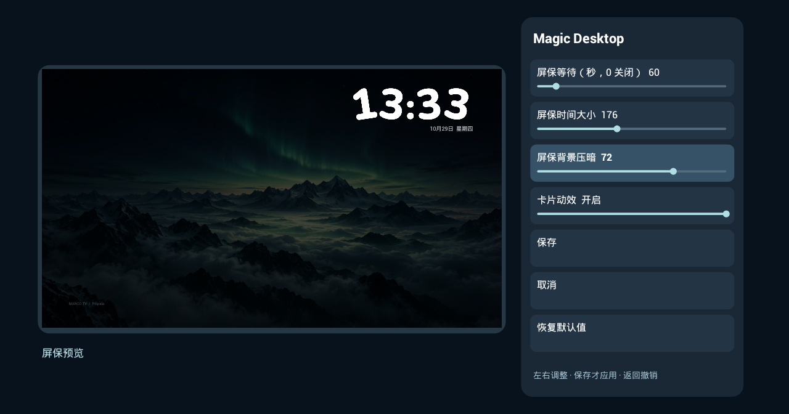
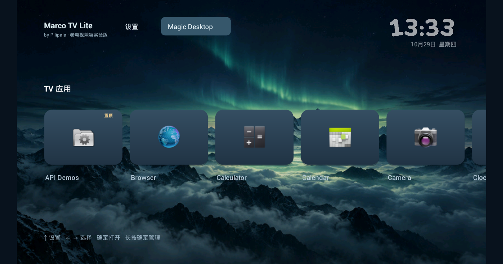
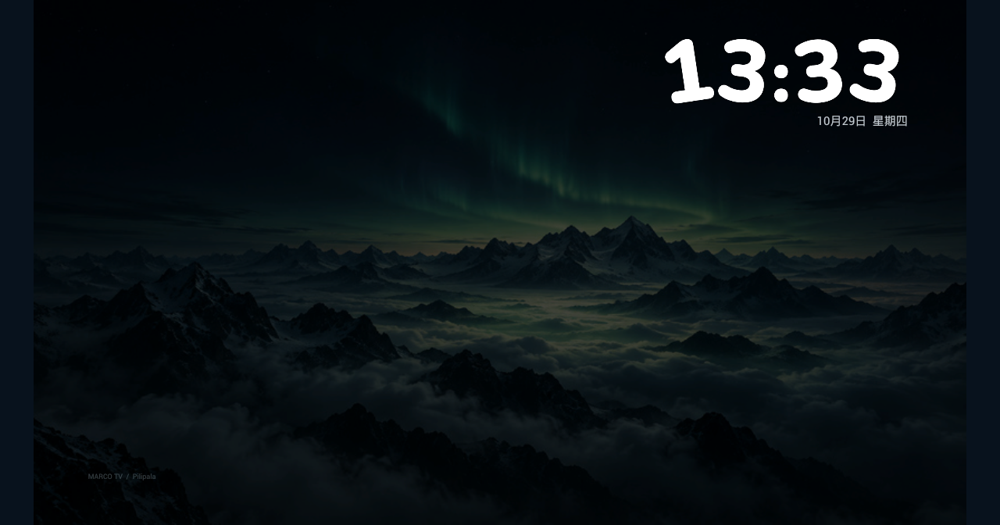

# Marco TV Lite

作者 **Pilipala** · **0.1.2 老电视兼容实验版** · [GPL-3.0-only](../LICENSE)

**本软件免费开源。如果你付费购买了本软件，请尽快向购买平台申请退款。**

面向 Android 4.0 起步的轻量桌面，独立于完整版安装和维护。本版使用真正的 Android API 14 编译，并在 Android 4.0.2 ARM 模拟器上完成 42 项基础运行检查、10 项稳定性检查和 20 项本地检查。**这不代表已经适配所有 Android 4.x 电视；没有老电视真机验证，暂作为实验版招募反馈。**

没有老电视也能先开发：模拟器负责安装、旧系统接口和基本操作验证；厂商 Home 键、遥控器、待机唤醒和实际流畅度由后续真机反馈补齐。不要仅凭型号或处理器判断完整兼容。

## 0.1.2 修复

- 恢复写入失败时报告未完成，不再提示成功；尝试还原恢复前配置，不对失败后的持久化状态作保证。
- 暂时离开页面保留导航位置和未保存草稿；返回、取消和 Home 仍可撤销草稿。通过系统提供的页面重建状态恢复草稿与返回路径。
- 时区变化后更新已有时钟，接收系统时间／时区变化并重新安排刷新。
- 新增存储故障注入、暂停恢复、状态序列化、时区变化与连续按键检查。状态 Bundle 恢复通过，不等于完整进程死亡与厂商待机验证完成。

## 0.1.1 更新

- 二级页面按进入来源返回，恢复原设置项与滚动位置；从首页进入 Magic Desktop 则返回首页。
- 调整屏保参数自动切到屏保预览，调整动效时演示卡片移动；草稿继续支持撤销。
- 返回桌面复用应用与图标缓存；安装、卸载、应用更新或手动刷新时重新扫描，合并重复刷新请求。
- 静止界面按分钟与闲置到期事件更新，取消每秒整页刷新。动画期间继续逐帧绘制。
- 卡片常显应用名称，增加缓存渐变与轻阴影，聚焦显示清晰边框。
- 两张壁纸压缩为 JPEG，四款数字字体保留。该变化降低下载体积，不等于已经证明所有老电视的内存或帧率改善。

## 版本怎么选

| 项目 | Marco TV 完整版 | Marco TV Lite 0.1.2 |
| --- | --- | --- |
| 最低系统声明 | Android 6.0 / API 23 | Android 4.0 / API 14，实验支持 |
| 应用包名 | com.pilipala.tvhome | com.pilipala.tvhome.lite |
| 基础桌面 | 完整卡片与分类管理 | 单行应用卡片、置顶、隐藏、最近打开／名称排序 |
| Magic Desktop | 3D 预览与完整调整项 | 平面缩小预览、11 项调整、保存／撤销 |
| 时钟与壁纸 | 四款字体、多种壁纸来源 | 同款四种数字字体、两张内置壁纸 |
| 屏保 | 完整版屏保选项 | 仅桌面前台闲置时显示时钟；不接管系统屏保 |
| Marco 互联、媒体播放卡片、系统最近任务 | 按系统权限提供 | 本版未提供 |
| Home 兼容与 ADB 恢复 | 按系统授权尝试 | 本版未提供，只声明普通 HOME 入口 |
| 更新 | 完整版在线更新渠道 | 手动覆盖安装 Lite，不接入完整版更新渠道 |
| 备份 | 完整版备份机制 | 仅本机内部外观快照；不与完整版互通 |

Lite 与完整版可以同时安装，设置分别保存。本版 APK 约 **301 KiB**（308,626 字节，比 0.1.0 缩小约 93%）；未申请联网权限，不上传使用数据。为控制开销，壁纸采用 836×470 JPEG，按设备应用堆内存预算解码最多 64 个应用图标，其余显示名称首字；仍会列出其余可启动应用。静止桌面在模拟器 2.2 秒观察窗口内未发生周期性重绘；尚未测量老电视上的帧率或长期内存表现。

## 安装与首次试用

1. 在电视「关于／系统信息」核对实际 Android 版本。不是 Android 或不能安装 APK 的系统，不适用此版本。
2. 下载文件名含 **MarcoTV-Lite-0.1.2.apk** 的实验包。普通完整版 APK 不能用于 Android 4.x。
3. 在电视中允许对应安装来源安装应用，通过厂商文件接收功能、浏览器、U 盘或已经授权的电脑 ADB 安装。品牌入口可参考[安装说明](../docs/安装说明.md)，其中完整版的授权和辅助服务步骤不适用于 Lite。
4. 从原厂应用列表打开 **Marco TV Lite**，先检查卡片、应用启动、方向键与返回键。
5. 如系统允许选择默认桌面，可再选择 Lite。厂商可能禁止或改写 Home 路径，本版不强制修改系统，也不需要停用原厂桌面。
6. 恢复时，从系统设置改回原厂默认桌面，或卸载 Lite。卸载会清除 Lite 设置与内部外观备份。

开发者可用 `adb -s <设备序列号> install --no-streaming -r MarcoTV-Lite-0.1.2.apk` 安装。先核对目标，不能假定模拟器与电视为同一设备。ADB 仅是可选安装方式，不是日常使用前提。

## 遥控器与设置

- 左右选择卡片，确定打开应用；向右超过第二张后整行左移。
- 上键进入顶部「设置」「Magic Desktop」，下键回卡片行。
- 长按确定打开单应用菜单：切换置顶、隐藏、系统应用信息。卸载由系统应用信息页提供，是否允许由系统决定。
- 设置中可恢复所有隐藏应用，切换最近打开／名称排序，切换两张内置壁纸；列表底部提供「刷新应用列表」。
- 设置与 Magic Desktop 中上下选择，左右调整参数；可滚动到「保存」「取消」「恢复默认值」。参数预览不会立即写入设置；保存才生效，返回或重新收到桌面 Home 启动请求会丢弃草稿。恢复默认值也要再选择保存。
- Magic Desktop 按进入来源返回：从设置进入回设置，从首页进入回首页；设备状态／关于页返回设置并恢复原选中项，设置返回桌面。Home 是否直接回到 Lite，取决于系统默认桌面设置。
- 时钟屏保中第一次按键只唤醒桌面，避免误开应用。系统自行待机或切换原厂屏保不在本版控制范围。

调整屏保等待、屏保时间大小或屏保压暗时，左侧显示「屏保预览」；选择其他外观项回到「桌面预览」。动效项会示范一次左右移动，预览不提前保存配置。

### Magic Desktop 参数

| 参数 | 可调范围 |
| --- | --- |
| 卡片行上下位置 | 0–100% |
| 卡片高度 | 70–130% |
| 卡片圆角 | 0–64 |
| 时钟字体 | 现代宽体、修长窄体、柔圆错倾、雅致衬线 |
| 圆体倾斜幅度 | 0–14° |
| 桌面时间大小 | 36–160 |
| 壁纸压暗 | 0–90 |
| 闲置等待 | 0–600 秒；0 为关闭，遥控器每次调整 10 秒 |
| 屏保时间大小 | 100–280 |
| 屏保压暗 | 0–100 |
| 动画 | 开／关 |

「保存本机外观备份」仅保存上述参数与当前内置壁纸选择，不包含置顶、隐藏、最近打开记录。备份保存在应用内部，无法用于跨电视迁移，卸载后也会删除；「恢复本机外观备份」遇到非法格式不会覆盖原配置。

## 界面展示与验证范围

以下是 **Android 4.0.2 模拟器中实际 View 绘制导出的图片**，不是电视实拍，也不是帧率证明。模拟器只有系统示例应用，没有用户私人内容。









[完整验证记录](validation.json)记录 APK 校验值、检查项目和未验证范围。已通过：Lite 覆盖安装、旧系统安装运行、应用发现与打开、方向键处理、四款字体绘制、预览／撤销／保存、外观备份异常保护、页面暂停后的动画与计时停止。

尚待真机：厂商 Home／长按／双击路径、遥控器按键映射、关屏唤醒、系统回收、长时间运行、不同分辨率与实际性能。Android 4.0.3/4.0.4、4.1–5.x 及其他架构没有逐项运行验证，不能把 API 14 模拟器通过等同于所有版本通过。

反馈请提交：电视品牌／型号、系统版本、固件版本、Lite 版本，以及具体哪一步成功或失败。通过 [GitHub Issues](https://github.com/Pilipala9919/MarcoTV/issues)反馈即可；截图请遮挡个人账号、Wi-Fi 名称、IP、序列号和私人应用。无需为了开始开发先购买一台老电视。

## 从源码构建

需要完整仓库，包括完整版共享的时钟绘制、动画、偏好草稿和字体资产。使用 Python 3.10+：

```text
python scripts/bootstrap.py
python scripts/build.py
python scripts/bootstrap_lite.py
python scripts/build_lite.py
python scripts/test_lite.py
python scripts/check_release.py
```

首次普通构建用于初始化本地开发签名，也可按[构建说明](../docs/构建说明.md)配置自己的签名。自行构建的开发签名不能保证覆盖官方包。产物为 `dist/MarcoTV-Lite-0.1.2.apk` 和同名 `.sha256` 文件。

`bootstrap_lite.py` 下载并校验 Google 官方 API 14 平台，默认不安装或启动模拟器；也可通过 `MARCOTV_API14_JAR` 指定相应 `android.jar`。Lite 编译使用 API 14 平台接口，DEX 最低目标也是 14，并保留 Android 4.0 安装所需的 v1 签名。

模拟器运行测试使用官方 Android 4.0.2 ARM/API 14 镜像，512 MB 内存、1280×720 配置，旧版经典模拟器，软件渲染。已安装 Lite 后运行：

```text
python scripts/test_lite_device.py --adb <adb路径> --serial <emulator序列号>
```

额外运行 `python scripts/test_lite_stability.py --adb <adb路径> --serial <emulator序列号>` 可执行 10 项稳定性检查，报告在 `build/lite-stability-tests/result.txt`。该套件结束会恢复内部备份与偏好。

此测试脚本拒绝非模拟器及非 API 14 目标。应使用专用可丢弃的测试模拟器：测试会覆盖内部外观备份、生成界面图，结束后恢复偏好设置；不是无副作用的用户设备诊断工具。运行报告写入 `build/lite-tests/result.txt`，本地检查写入 `build/lite-local-tests/result.json`。

旧模拟器下载来源为 Google 的 `tools_r25.2.5-windows.zip` 与 `sys-img/android/sysimg_armv7a-14_r02.zip`，版本和校验值见验证记录。只用于隔离测试，不分发这些 SDK 文件，也不用于日常浏览或处理账号资料。

## 开源说明

Lite 源码采用 [GPL-3.0-only](../LICENSE)，作者 Pilipala。共享代码及素材说明见 [NOTICE](../NOTICE)与[资产说明](../assets-notes.md)；四款壁纸压缩参数、原图与产物哈希见[Lite 壁纸来源](src/main/assets/wallpapers/sources.json)。字体的来源、哈希与许可见[字体来源](../app/src/main/assets/fonts/sources.json)和 `licenses/*-OFL.txt`。应用「关于与开源许可」中按确定可查看随包许可全文。
